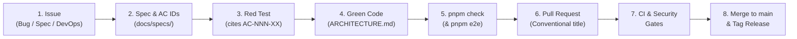

# Contributing to Kritzel

Welcome! Kritzel is a self-hosted, ad-free draw-and-guess party game built as a TypeScript monorepo. We follow a **spec-driven** workflow: specifications define behaviour, tests prove acceptance criteria, and code follows.

Before writing code, please read our [Code of Conduct](CODE_OF_CONDUCT.md) and review [AGENTS.md](AGENTS.md) and [CONTEXT.md](CONTEXT.md).

## Ticket-to-PR Workflow



1. **Open or claim an issue.** Use our issue forms for [Bug reports](.github/ISSUE_TEMPLATE/bug_report.yml), [Feature / Spec proposals](.github/ISSUE_TEMPLATE/feature_spec.yml), or [DevOps / Infrastructure tasks](.github/ISSUE_TEMPLATE/devops_task.yml).
2. **Update the spec first (for behaviour changes).** Edit or create the relevant spec in [`docs/specs/`](docs/specs/README.md) with concrete `AC-NNN-XX` acceptance criteria. Add any new domain terms to [`CONTEXT.md`](CONTEXT.md).
3. **Write a failing test (Red).** Cite the criterion ID in the test title, e.g. `it('AC-005-03: the first correct guess earns the bonus', ...)`, and watch it fail.
4. **Implement the change (Green).** Place code in the module assigned by [`docs/ARCHITECTURE.md`](docs/ARCHITECTURE.md).
5. **Run local verification.** Run `pnpm check` (lint, format check, typecheck, unit tests, and strict spec coverage). Run `pnpm e2e` if your change touches `apps/web`, the protocol, or the game flow.
6. **Open a Pull Request.**
   - Use a **Conventional Commits** PR title: `<type>[optional (scope)][!]: <description>` (allowed types: `feat`, `fix`, `chore`, `ci`, `docs`, `refactor`, `perf`, `test`, `build`, `revert`, `security`).
   - Fill out the [PR template](.github/PULL_REQUEST_TEMPLATE.md), linking the issue (`Closes #...`) and listing the spec and `AC-NNN-XX` IDs.
7. **Pass CI and security gates.** Every PR runs CI (`check`, `build`, `e2e`, container image test, live observability test), PR hygiene (title check, version sync check, auto-labelling), and security checks (production dependency audit, dependency review, CodeQL, gitleaks secret scan).
8. **Merge and release promotion.** Merges to `main` build a single multi-arch image (`sha-<commit>`), test, scan, and sign it, then advance `edge`. Releases promote an already-verified digest from `main` via a `vX.Y.Z` tag ([spec 017](docs/specs/017-release-and-supply-chain.md)).

## Local Setup

### Prerequisites

- **Node.js 22+** (see `.nvmrc`)
- **pnpm 10** (`corepack enable` or `npm i -g pnpm@10`)
- **Docker** (optional, required for container image tests and the local observability stack)

### Common Commands

```bash
# Install dependencies
pnpm install

# Start web client and server in development mode
pnpm dev

# Full quality gate (lint, format check, typecheck, unit tests, strict spec coverage)
pnpm check

# Auto-format files with Prettier
pnpm format

# End-to-end Playwright tests against built app and server
pnpm e2e

# Start and verify the local observability stack (OTel, Prometheus, Loki, Tempo, Grafana)
pnpm obs:up
pnpm obs:status
pnpm obs:down
```

## Architecture & Design Rules

All contributions must respect the project boundaries documented in [`AGENTS.md`](AGENTS.md) and [`docs/ARCHITECTURE.md`](docs/ARCHITECTURE.md):

- **Pure rules in `packages/shared`:** Game logic lives in `packages/shared` as pure functions. Pass time (`ctx.now`) and randomness (`ctx.random`) as arguments; use `scheduleTimer` effects instead of wall-clock timers.
- **Server-authoritative visibility via `viewFor`:** The server decides and the client renders. The secret word and private participant data reach clients exclusively through `viewFor`.
- **Single source of constants:** Spec constants are defined once in `packages/shared` and imported everywhere else.
- **4-locale i18n:** Every visible UI string must go through `t()` with translations in `en`, `de`, `es`, and `fr`. German, Spanish, and French copy addresses the player informally.
- **Design tokens:** Use design tokens from [`docs/DESIGN.md`](docs/DESIGN.md); raw hex values belong only in the token file and the drawing palette.
- **Same-origin only:** Fonts, icons, sounds, and datasets are bundled. Never add dependencies or assets that contact external hosts at runtime.
- **No secrets or PII in logs/telemetry:** Logs and spans carry counts and room codes only where explicitly specified — never nicknames, chat text, secret words, session tokens, or credentials.
- **Package boundaries:** Packages import each other only through their package root (`src/index.ts`). `apps/web` and `apps/server` never import each other.
- **Workflow supply-chain hygiene:** External GitHub Actions must be pinned to a full 40-character commit SHA with a `# vX.Y.Z` comment, tool container images must be pinned by `sha256` digest, and every workflow job must define `timeout-minutes`.

## Security

Do **not** report security vulnerabilities in public issues or pull requests. Follow [`SECURITY.md`](SECURITY.md) to report vulnerabilities privately via GitHub Security Advisories.
