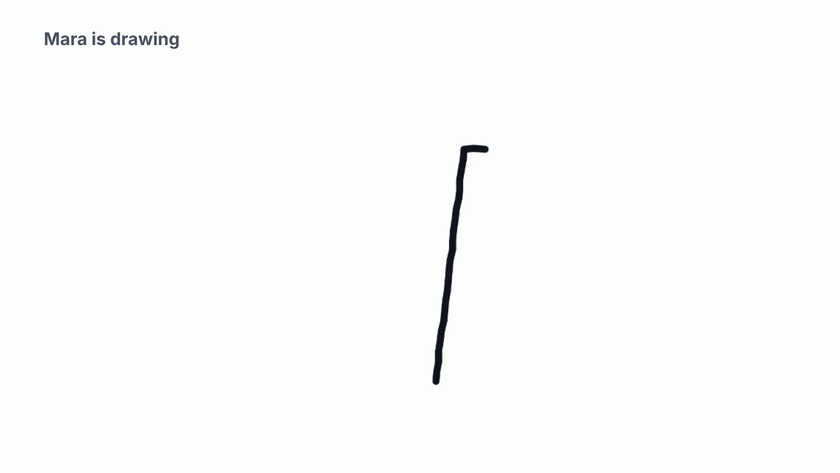
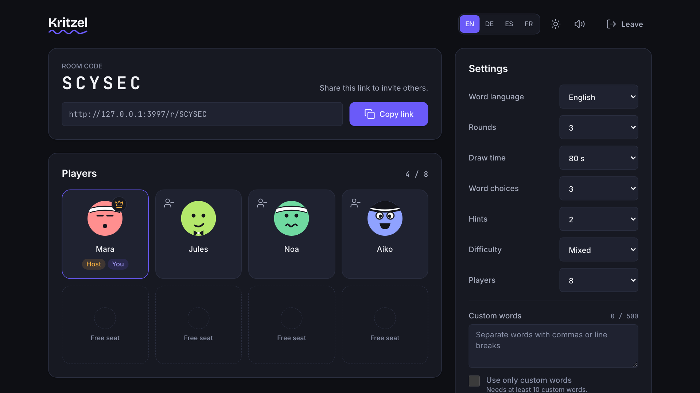
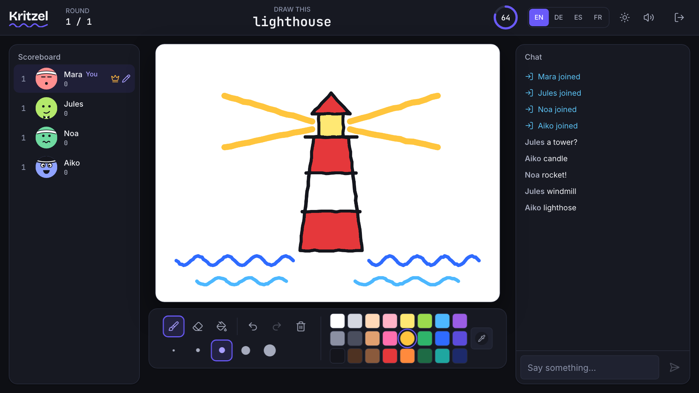
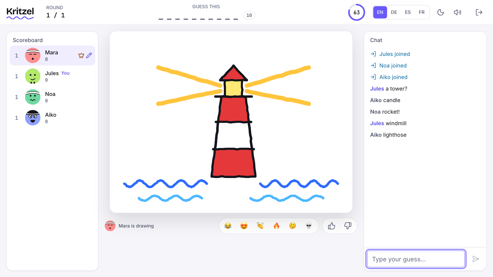
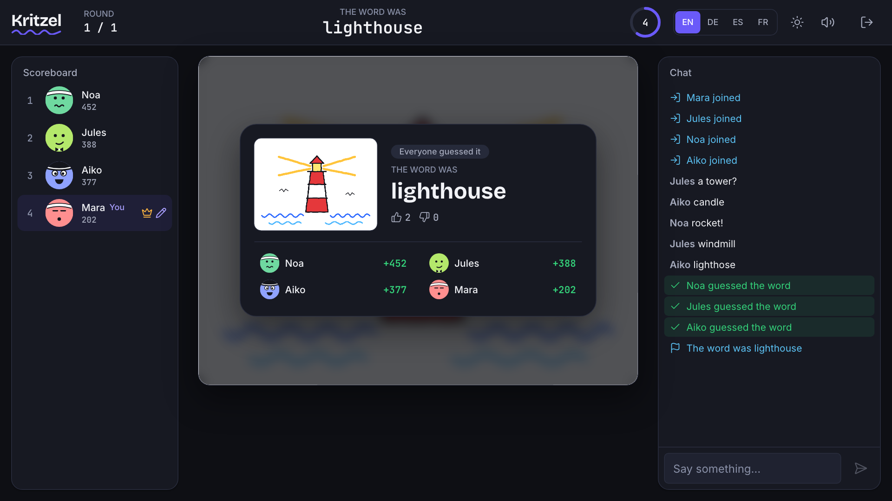
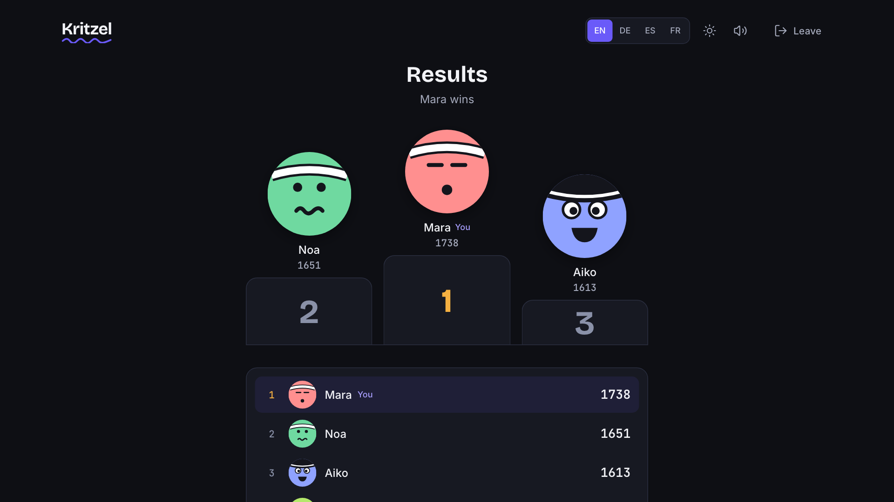
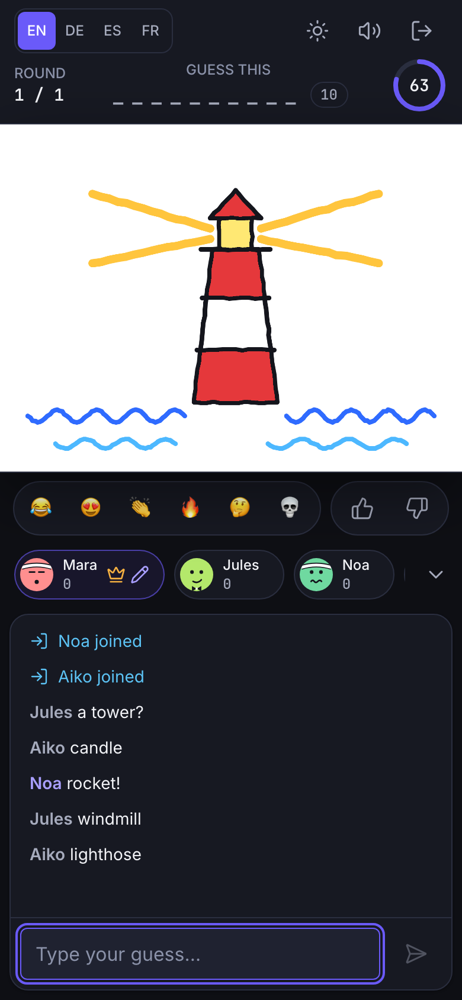
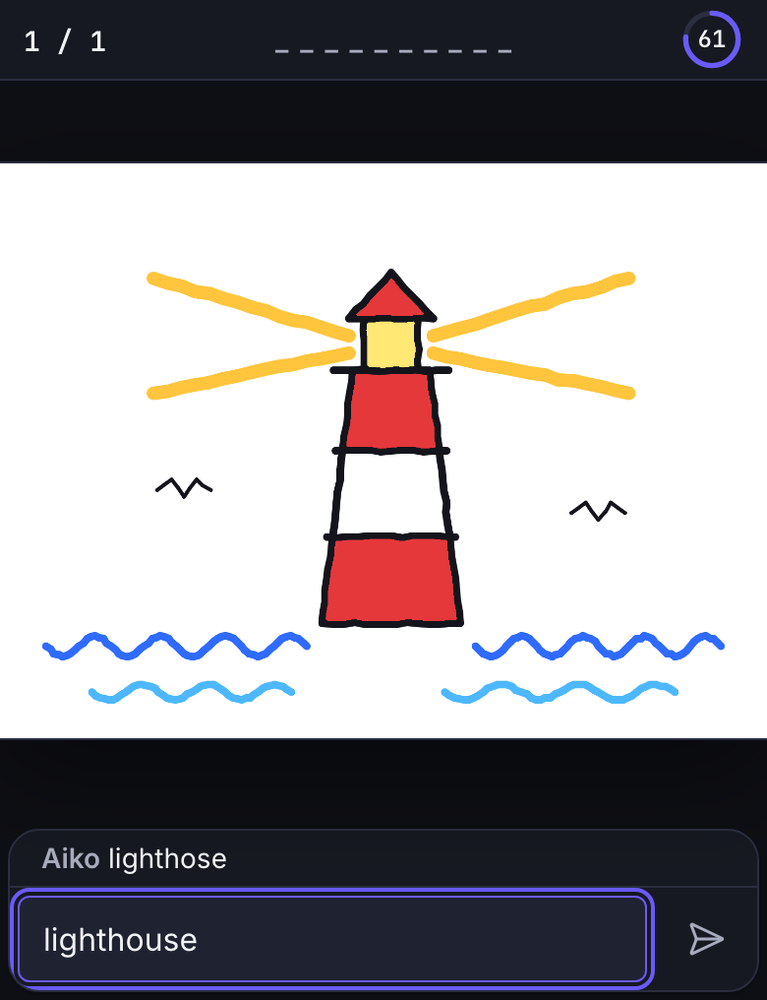
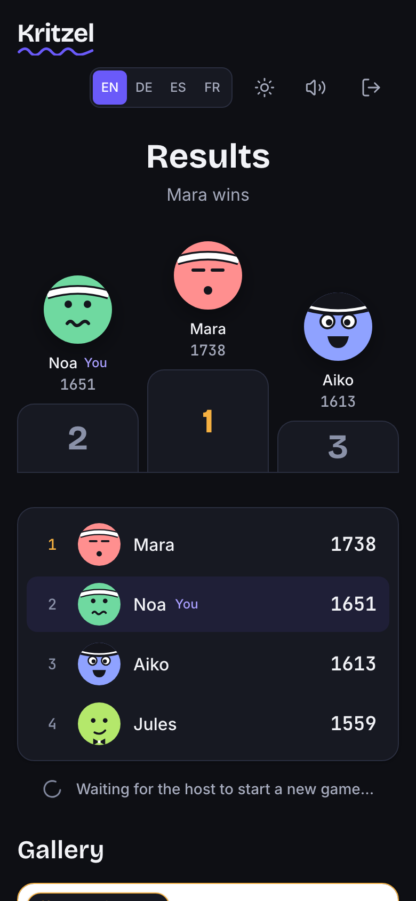
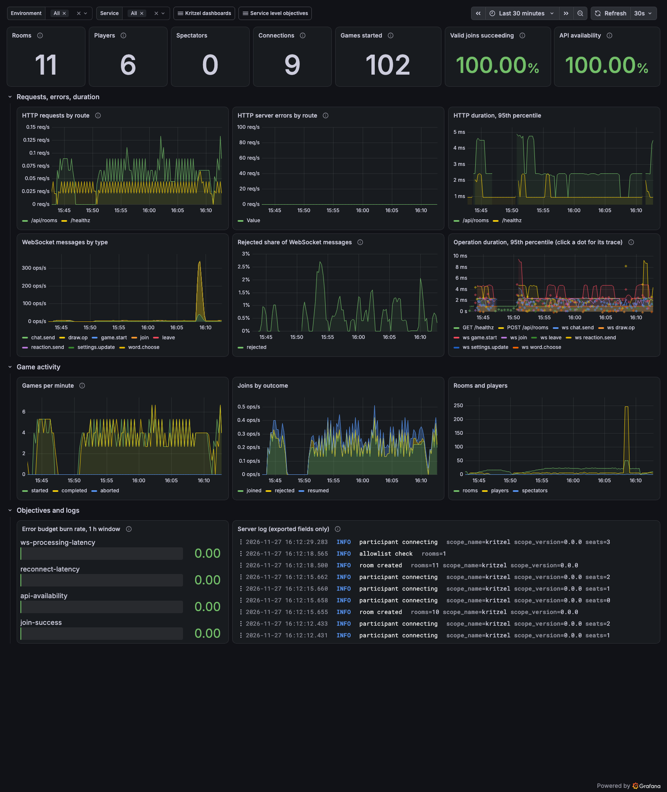

<div align="center">

# Kritzel

**Draw. Guess. No ads.**

The draw-and-guess party game you host yourself.<br>
One command starts it, one link invites your friends, and nobody is tracked while a lighthouse gets mistaken for a rocket.

[](https://github.com/Mistral-valaise/open-skribbl/actions/workflows/ci.yml)
[](https://github.com/Mistral-valaise/open-skribbl/releases/latest)
[](LICENSE)

<a href="marketing/promo/dist/kritzel-promo.mp4"></a>

[Watch the 30-second film](marketing/promo/dist/kritzel-promo.mp4) · [Host it](#host-it-in-one-command) · [See the screens](#a-round-in-pictures) · [Read the docs](#documentation)

</div>

## Why Kritzel

|                                                                                                                                                           |                                                                                                                                                                                                          |
| --------------------------------------------------------------------------------------------------------------------------------------------------------- | -------------------------------------------------------------------------------------------------------------------------------------------------------------------------------------------------------- |
| **One command to host.** A single container, no database, no configuration. It runs on a laptop, a small server or a cluster.                             | **Nothing between you and the game.** No ads, no accounts, no tracking. The page loads from your server and talks to your server, and to nobody else.                                                    |
| **Send a link, start playing.** Private rooms for 2 to 12 players plus spectators. Friends open the link, pick a nickname and an avatar, and they are in. | **Every screen, four languages.** Phone, tablet and desktop get the same game, in a dark and a light theme, in English, German, Spanish and French. On a phone the drawing stays in view while you type. |

## Host it in one command

```bash
docker run -d -p 3000:3000 ghcr.io/mistral-valaise/open-skribbl
```

Open <http://localhost:3000>, create a room and share its link. That is the whole setup.

The image is built once, played through by the test suite, scanned for known vulnerabilities and signed before it is published; [`docs/HOSTING.md`](docs/HOSTING.md) explains the tags, how to verify the signature, configuration, and reverse proxies (Caddy, nginx, Traefik) for hosting it beyond your own machine.

## A round in pictures

| Gather in the lobby                                                                                           | Draw the word                                                                                                        |
| ------------------------------------------------------------------------------------------------------------- | -------------------------------------------------------------------------------------------------------------------- |
|  |  |
| **Guess it, in the light theme too**                                                                          | **See who was fastest**                                                                                              |
|    |        |

A faster guess earns more points, the first right guess earns a bonus, and the drawer earns half of what the guessers average, so a game for two is not a permanent tie. After the last round the podium and a gallery of every drawing appear:



The same game on a phone, including the moment the keyboard opens:

<p align="center">
  
  &nbsp;&nbsp;
  
  &nbsp;&nbsp;
  
</p>

Every picture here, and every frame of the film, is a recording of a real game: [`scripts/readme-media.mjs`](scripts/readme-media.mjs) plays one in four browsers and captures it.

## What you get

- Private rooms by link or six-character code, 2–12 players plus spectators
- Brush, eraser, fill, undo and redo, on mouse, touch and stylus
- Tolerant guessing (accents, umlauts, spacing), close-guess notices, a separate chat for those who already guessed
- Scoring that rewards speed: 100 to 500 points for a guess, a bonus for the first, and a share for the drawer
- Host settings: rounds, draw time, word choices, hints, difficulty, custom words
- Reconnect without losing points, late join, host migration
- Reactions, likes, results with podium and a gallery of all drawings with PNG download
- Solo mode: the computer draws, you guess, beat your personal best
- Light and dark theme, phone to desktop, keyboard and screen-reader support
- One Docker image, no database, no configuration required

> **Version 1.0.0** is the first release. The [changelog](CHANGELOG.md) lists what is in it, the [roadmap](docs/ROADMAP.md) what comes next (bots, team mode).

🇩🇪 Kritzel ist ein quelloffenes Zeichnen-und-Raten-Spiel zum Selbsthosten: private Räume fürs Team, ohne Werbung, ohne Konten, ohne Tracking. Auf Deutsch, Englisch, Spanisch und Französisch, mit Solo-Modus gegen den Computer.

🇪🇸 Kritzel es un juego de dibujar y adivinar de código abierto que alojas tú mismo: salas privadas para tu equipo, sin anuncios, sin cuentas y sin rastreo. En español, inglés, alemán y francés, con modo en solitario contra el ordenador.

🇫🇷 Kritzel est un jeu de dessin et de devinettes open source à héberger soi-même : des salons privés pour ton équipe, sans publicité, sans compte et sans pistage. En français, anglais, allemand et espagnol, avec un mode solo contre l'ordinateur.

## Repository map

```
apps/web          React client (Vite)
apps/server       Node server (HTTP + WebSocket)
packages/shared   Game rules, protocol and drawing model as pure TypeScript
deploy/           Helm chart and deployment scripts
docs/             Product, architecture and design documents, specs, decisions
marketing/promo   Source of the promo film
scripts/          Repository tooling
```

## Documentation

| Document                                       | Content                                                     |
| ---------------------------------------------- | ----------------------------------------------------------- |
| [Product requirements](docs/PRD.md)            | Goals, non-goals, scope, quality requirements, decision log |
| [Architecture guideline](docs/ARCHITECTURE.md) | Modules, protocol, drawing pipeline, testing, deployment    |
| [Design guideline](docs/DESIGN.md)             | Brand, tokens, components, screens, accessibility           |
| [Specs](docs/specs/README.md)                  | One spec per feature with numbered acceptance criteria      |
| [Hosting](docs/HOSTING.md)                     | Docker, published images, configuration, reverse proxies    |
| [Observability](docs/OBSERVABILITY.md)         | Optional telemetry, the local stack, dashboards, objectives |
| [Runbook](docs/RUNBOOK.md)                     | What to do when an alert fires                              |
| [Security policy](SECURITY.md)                 | Supported versions and how to report a vulnerability        |
| [Changelog](CHANGELOG.md)                      | What changed in each release                                |
| [Roadmap](docs/ROADMAP.md)                     | Milestones and what comes after v1                          |
| [Decisions](docs/adr/)                         | Architecture decision records                               |
| [Glossary](CONTEXT.md)                         | The project's vocabulary                                    |
| [Agent instructions](AGENTS.md)                | How coding agents and contributors work in this repository  |

## Spec-driven development

Behaviour is defined in `docs/specs/` before it is written in code. Each spec lists acceptance criteria with stable ids such as `AC-005-03`; each test names the criteria it proves; a tool reports the gaps.

1. Change or add the spec.
2. Write a failing test that cites the criterion.
3. Implement until it passes.
4. Run `pnpm check`.

This is the same loop for people and for coding agents. `AGENTS.md` (loaded by `CLAUDE.md`) gives agents the map, the loop and the project's non-obvious rules.

## Development

Requirements: Node.js 22 or newer and pnpm 10.

```bash
pnpm install
```

```bash
pnpm dev
```

```bash
pnpm check
```

`pnpm dev` starts the server on port 3000 and the web client on port 5173 in watch mode; open the web client's address. `pnpm check` runs lint, formatting, type check, tests and spec coverage; CI runs the same command. `pnpm spec:coverage` alone prints the coverage table. `pnpm e2e` plays full games in a real browser (it needs Chromium: `pnpm exec playwright install chromium`).

## Hosting

To build the image yourself instead of pulling the published one:

```bash
docker build -t kritzel .
```

```bash
docker run -d -p 3000:3000 kritzel
```

Then open <http://localhost:3000>. No database and no configuration are needed. [`docs/HOSTING.md`](docs/HOSTING.md) covers configuration, reverse proxies (Caddy, nginx, Traefik), hosting platforms and measured capacity.

## Observability

Telemetry is optional and off by default: without configuration the server exports nothing and opens no outbound connection. To send metrics, traces and logs to an OpenTelemetry collector over OTLP/HTTP, set two variables on the container:

```
TELEMETRY_ENABLED=true
OTEL_EXPORTER_OTLP_ENDPOINT=http://collector.example.internal:4318
```

To try it locally with a collector, Prometheus, Loki, Tempo and Grafana with dashboards already in place:

```bash
pnpm obs:up
```

Grafana is then on <http://127.0.0.1:3001> (user `admin`, generated password in `.env.observability`). Exported telemetry contains counts and durations, never nicknames, chat, words, drawings or room codes. [`docs/OBSERVABILITY.md`](docs/OBSERVABILITY.md) lists everything that is exported; [`docs/RUNBOOK.md`](docs/RUNBOOK.md) explains the alerts.



Kritzel can also run on a cluster: a Helm chart installs the game alone or together with this stack, and a workflow keeps a demo on the OpenShift Developer Sandbox. See [docs/DEPLOYMENT-OPENSHIFT.md](docs/DEPLOYMENT-OPENSHIFT.md).

## Contributing

Read [`AGENTS.md`](AGENTS.md) first; it applies to human contributors too. Word lists and translations are especially welcome: the interface dictionaries are in `apps/web/src/i18n/`, the word lists in `packages/content/words/`.

## Licence and credits

[MIT](LICENSE). Third-party material is listed in [`NOTICE.md`](NOTICE.md).

Created by [Mistral N](https://mistraln.de/).
