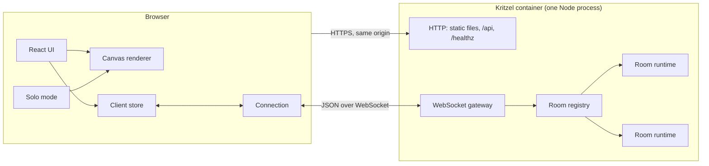

# Kritzel — Architecture Guideline

|            |                                  |
| ---------- | -------------------------------- |
| Status     | Proposed (awaiting owner review) |
| Vocabulary | [`CONTEXT.md`](../CONTEXT.md)    |
| Decisions  | [`docs/adr/`](adr/)              |

This document describes the shape of the system and the rules every change follows. Behaviour lives in the specs; this document says where that behaviour is implemented and how the parts talk to each other.

## 1. System overview



One Node process serves the built web app, a tiny HTTP API and one WebSocket endpoint. All state is in memory ([ADR 0001](adr/0001-single-process-in-memory-state.md)). The server is authoritative: clients send intents, the server validates them, updates the room and tells each participant what they are allowed to see.

## 2. Repository layout

```
apps/
  web/        React client (Vite, Tailwind)
  server/     Node server (HTTP + WebSocket)
packages/
  shared/     Rules, protocol and drawing model: pure TypeScript, no I/O
  content/    Word lists and solo drawings: data plus typed loaders
docs/         PRD, this file, DESIGN, specs, ADRs, roadmap
scripts/      Repository tooling (spec coverage, dataset build)
e2e/          Playwright tests (added in M1)
```

### Dependency rules

```
web ──► shared ◄── server
 │         ▲          │
 └──► content ◄───────┘
```

- `shared` depends on nothing but `zod`. It never touches the network, timers, the DOM, `Date.now()` or `Math.random()`; time and randomness are passed in.
- `content` depends on `shared` for types only.
- `web` and `server` never import each other.
- Each package exposes its public surface through `src/index.ts`; other packages import only from the package root.

## 3. `packages/shared`

The heart of the game. Everything here is a pure function with unit tests that name the acceptance criterion they prove.

| Module         | Responsibility                                                                                     | Specs              |
| -------------- | -------------------------------------------------------------------------------------------------- | ------------------ |
| `protocol.ts`  | Zod schemas for client messages, types for server messages and views, settings, `PROTOCOL_VERSION` | all                |
| `game/`        | Room state, the reducer (`reduce`), per-participant views (`viewFor`)                              | 001, 002, 004, 007 |
| `scoring.ts`   | Guess points, drawer points, ranking                                                               | 005                |
| `words/`       | Normalisation, matching, close guess, mask and hint schedule, word selection                       | 004, 006           |
| `drawing.ts`   | Op schemas, effective items, op-log reduction (undo, redo, clear), limits                          | 003                |
| `identity.ts`  | Nickname and avatar validation                                                                     | 010                |
| `constants.ts` | Every number a spec names, defined once                                                            | all                |

### Game engine

The engine is a reducer ([ADR 0003](adr/0003-pure-reducer-game-engine.md)):

```ts
reduce(state: RoomState, event: RoomEvent, ctx: { now: number; random: () => number }):
  { state: RoomState; effects: Effect[] }
```

- **Events** are everything that can happen to a room: a validated client intent (`playerJoined`, `wordChosen`, `guessSubmitted`, …) or a timer firing (`phaseTimerFired`, `hintTimerFired`, `graceExpired`).
- **Effects** are instructions for the runtime: `broadcastState`, `sendTo(participant, message)`, `scheduleTimer(key, at)`, `cancelTimer(key)`, `disposeRoom`.
- `viewFor(state, participantId)` projects the state into the snapshot one participant may see. The word is present only for the drawer, for players who guessed, and for everyone after the turn ends. This function is the single place that decides visibility.

Phases and transitions are specified in [spec 002](specs/002-game-loop.md).

## 4. Protocol

### Transport

- One WebSocket endpoint: `GET /ws`. Messages are UTF-8 JSON objects with a string `type` field.
- Every inbound message is parsed with its Zod schema. Unknown types, invalid payloads and oversized frames (over 16 KB) are dropped and answered with `error`.
- The first message on a connection must be `join`; it carries `protocolVersion`. On mismatch the server answers `error { code: "version_mismatch" }` and the client reloads.
- The server sends WebSocket pings every 15 s and closes connections that miss two.

### Synchronisation model

Two mechanisms, chosen per kind of data ([ADR 0004](adr/0004-snapshots-plus-streams.md)):

- **Room state → full snapshots.** After every state change the server sends each participant their `room.state` view. Snapshots are small (no drawing data) and make reconnects and late joins trivial.
- **Drawing, chat, reactions → streams.** These are append-only and high-frequency; they are relayed as individual messages. A joining participant receives the current turn's op log once, inside `joined`.

Snapshots carry `serverNow` and absolute deadlines (`phaseEndsAt`); the client derives its clock offset and renders countdowns locally.

### Message catalogue

`packages/shared/src/protocol.ts` is authoritative; this table is an overview. Messages marked M2 are not implemented yet.

| Direction | Type              | Payload                                                                      | Notes                                                          |
| --------- | ----------------- | ---------------------------------------------------------------------------- | -------------------------------------------------------------- |
| C→S       | `join`            | `protocolVersion, roomCode, nickname, avatar, role, clientId, sessionToken?` | First message. `sessionToken` resumes a seat.                  |
| C→S       | `leave`           | —                                                                            | Gives up the seat at once.                                     |
| C→S       | `settings.update` | partial settings                                                             | Host, lobby only.                                              |
| C→S       | `game.start`      | —                                                                            | Host, lobby only.                                              |
| C→S       | `game.playAgain`  | —                                                                            | Host, game end only.                                           |
| C→S       | `player.kick`     | `playerId`                                                                   | Host.                                                          |
| C→S       | `word.choose`     | `index`                                                                      | Drawer, choosing phase.                                        |
| C→S       | `draw.op`         | `op`                                                                         | Drawer, drawing phase.                                         |
| C→S       | `chat.send`       | `text`                                                                       | Guess or chat; the server decides.                             |
| C→S       | `reaction.send`   | `emoji`                                                                      | M2.                                                            |
| C→S       | `like.set`        | `value: "up" \| "down"`                                                      | M2.                                                            |
| C→S       | `gallery.get`     | `turnIndex`                                                                  | Game end only. M2.                                             |
| S→C       | `joined`          | `participantId, sessionToken, state, items`                                  | `items` are the effective drawing items of the current turn.   |
| S→C       | `room.state`      | per-participant snapshot                                                     |                                                                |
| S→C       | `word.choices`    | `words[]`                                                                    | Drawer only.                                                   |
| S→C       | `draw.op`         | `op`                                                                         | Everyone except the sender.                                    |
| S→C       | `chat.message`    | `id, channel, kind, from?, text?, key?, params?`                             | `kind: "chat" \| "system"`; system messages carry an i18n key. |
| S→C       | `guess.feedback`  | `kind: "correct" \| "close"`, `text`                                         | Sender only.                                                   |
| S→C       | `reaction`        | `participantId, emoji`                                                       | M2.                                                            |
| S→C       | `gallery.drawing` | `turnIndex, opLog`                                                           | M2.                                                            |
| S→C       | `kicked`          | —                                                                            | Followed by close.                                             |
| S→C       | `server.shutdown` | —                                                                            | Graceful stop.                                                 |
| S→C       | `error`           | `code`                                                                       | Codes map to i18n keys on the client.                          |

### HTTP API

| Method | Path               | Purpose                                                                                          |
| ------ | ------------------ | ------------------------------------------------------------------------------------------------ |
| `POST` | `/api/rooms`       | Create a room; returns `{ code }`. Rate-limited per IP.                                          |
| `GET`  | `/api/rooms/:code` | `200 { exists: true, joinable }` or `404`; lets the client show a clear error before connecting. |
| `GET`  | `/healthz`         | Liveness: `200 { "status": "ok" }`.                                                              |
| `GET`  | `/*`               | Static web app with SPA fallback; `/content/*` serves solo data.                                 |

### Abuse limits

Token buckets per connection: drawing 90 messages/s, chat 5 burst then 1/s, reactions 1 per 1.5 s. Excess messages are dropped; a connection that has 50 messages dropped within 10 s is closed. Room creation: 10 per minute per IP. Size limits for nicknames, chat text, strokes and op logs are constants in `shared/constants.ts` and are quoted in the specs.

## 5. Drawing pipeline

Drawings are transmitted and stored as an op log, never as pixels ([ADR 0002](adr/0002-drawing-as-op-log.md)).

1. **Capture.** Pointer events on the drawer's canvas are converted to logical coordinates (800 × 600), thinned, batched every 33 ms and sent as `draw.op`.
2. **Authority.** The server validates each op, applies it to the turn's op log (`shared/drawing`) and relays it. Undo and redo are ops; server and clients run the same `applyOp`, so everyone arrives at the same effective items. A joining participant receives those items, not the raw ops.
3. **Render.** `web` renders the effective items onto a canvas whose backing store is always 1600 × 1200 (twice the logical size), on every device, so flood fills see the same pixels everywhere; CSS scales it to the layout. Strokes append incrementally; undo, redo and joining trigger a full redraw.
4. **Reuse.** The same renderer serves the live game, the gallery, PNG export and the solo replay.

Details and limits are in [spec 003](specs/003-drawing.md).

## 6. `apps/server`

| Module           | Responsibility                                                                                 |
| ---------------- | ---------------------------------------------------------------------------------------------- |
| `http/`          | Static files, `/api`, `/healthz`, security headers                                             |
| `gateway/`       | WebSocket lifecycle, parsing, validation, rate limiting, heartbeat                             |
| `rooms/registry` | Create, look up and dispose rooms; room-code generation; capacity                              |
| `rooms/runtime`  | One per room: owns the `RoomState`, feeds events to the reducer, executes effects, owns timers |
| `config`         | Environment variables with defaults and validation                                             |
| `log`            | Structured JSON logging                                                                        |

Rules:

- A room runtime processes one event at a time; all mutation of a room goes through `reduce`.
- The runtime owns the real clock, the real random source and real timers and injects them, so tests drive rooms with a fake clock.
- Nothing in a room is written to disk or logged beyond counts and room codes. Chat text, words and nicknames never reach the logs.
- Framework choice: Fastify with `@fastify/websocket` and `@fastify/static`.

## 7. `apps/web`

| Area          | Responsibility                                                                 |
| ------------- | ------------------------------------------------------------------------------ |
| `app/`        | Routes (`/`, `/r/:code`, `/solo`), providers, error boundary                   |
| `connection/` | WebSocket client: join, resume, backoff reconnect, clock offset                |
| `store/`      | Zustand store holding the latest snapshot, chat log, op log and local UI state |
| `features/`   | One folder per screen or feature: `home`, `lobby`, `game`, `results`, `solo`   |
| `canvas/`     | Renderer, pointer capture, flood fill, PNG export, replay                      |
| `ui/`         | Design-system components from [`DESIGN.md`](DESIGN.md)                         |
| `i18n/`       | Typed dictionaries (`en`, `de`, `es`, `fr`) and the `t()` helper               |
| `audio/`      | Web Audio synthesised sound effects                                            |

Rules:

- The client holds no game rules. It renders snapshots and sends intents; optimistic rendering is used only for the drawer's own strokes.
- Every visible string goes through `t()`. `en.ts` defines the keys; `de.ts` and `es.ts` must satisfy the same type, so a missing translation is a compile error.
- Styling uses Tailwind utilities bound to the design tokens in `DESIGN.md`; raw colour values appear only in the token file and the drawing palette.
- Fonts, icons and any other asset are bundled. The app issues no cross-origin request.
- Player preferences (nickname, avatar, language, theme, mute, `clientId`, solo best) live in `localStorage`; the per-room `sessionToken` lives in `sessionStorage`.

## 8. Solo mode

Solo mode runs entirely in the browser ([ADR 0005](adr/0005-client-side-solo-on-open-dataset.md)): it loads category and drawing files from `/content/solo/`, replays strokes through the shared canvas renderer and scores with the same functions as multiplayer. Behaviour is in [spec 009](specs/009-solo-mode.md).

## 9. `packages/content`

```
words/<lang>/{easy,medium,hard}.txt   one word per line, '#' comments
solo/categories.json                  id plus en/de/es/fr label per category
solo/drawings/<id>.json               curated drawings per category
```

Word lists are read by the server at start-up. Solo files are copied into the web build. `scripts/build-solo-dataset.mjs` regenerates the solo files from the Quick, Draw! dataset; its output is committed so builds are offline and reproducible. Attribution lives in `NOTICE.md`.

## 10. Testing strategy

| Layer       | Tool                            | What it proves                                                                                             |
| ----------- | ------------------------------- | ---------------------------------------------------------------------------------------------------------- |
| Unit        | Vitest                          | Pure functions in `shared` and `content` validation: rules, scoring, matching, op log, reducer transitions |
| Integration | Vitest + real WebSocket clients | Server behaviour over the wire with a fake clock: visibility, validation, rate limits, reconnect           |
| Component   | Vitest + Testing Library        | Critical UI logic: mask rendering, settings form, chat routing                                             |
| End-to-end  | Playwright                      | Two browsers play a full game; language switch; solo run; same-origin network check                        |

Tests name the acceptance criteria they cover in their title (`it('AC-005-03: …')`). `pnpm spec:coverage` reports criteria without a test; see [`docs/specs/README.md`](specs/README.md).

## 11. Build and deployment

- `pnpm build` produces `apps/web/dist` and `apps/server/dist`.
- The Docker image is multi-stage: build with pnpm, then a slim Node runtime containing the server bundle, its production dependencies, the web build and the content. It runs as a non-root user and listens on `PORT` (default 3000).
- Configuration is by environment variables only; the full list is in [spec 012](specs/012-deployment-and-operations.md).
- TLS and WebSocket upgrade are terminated by the operator's reverse proxy; the README documents Caddy, nginx and Traefik.
- CI (GitHub Actions) runs lint, type check, tests, spec coverage and build on every pull request and on `main`; a release workflow publishes the image to GHCR from `main` and from `v*` tags.

## 12. Security and privacy

- All client input is untrusted: schema validation, length limits and rate limits at the gateway; authorisation (host-only, drawer-only, phase checks) in the reducer.
- A seat is held by a random 128-bit `sessionToken` known only to its browser tab. Participant ids are public; tokens are never broadcast.
- Chat text is rendered as text, never as HTML.
- Response headers: a Content-Security-Policy restricted to `'self'`, `X-Content-Type-Options: nosniff`, `Referrer-Policy: no-referrer`.
- The secret word is sent only to participants allowed to see it; guessers receive the mask.

## 13. Conventions

- TypeScript strict mode everywhere; `unknown` at boundaries, narrowed by Zod.
- Names come from `CONTEXT.md`. A new domain concept gets a glossary entry in the same change.
- Constants that appear in a spec (timings, limits, score values) are defined once in `shared` and imported everywhere else.
- Errors that a player can cause are values (`error` messages with a code); exceptions are for programmer mistakes.
- ES modules, named exports, one concept per file, tests next to the code as `*.test.ts`.
- A new runtime dependency needs a sentence of justification in the pull request; one that would make a network request at runtime is rejected.
