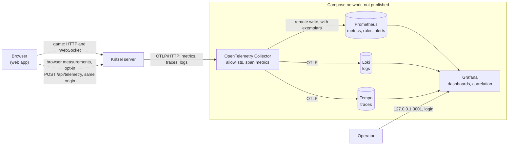

# Observability

Kritzel can export telemetry for its operator: metrics, traces and logs over OpenTelemetry (OTLP/HTTP). It answers whether an instance is healthy and why it is not, without recording anything the players said or drew.

Telemetry is **off by default**. A server started without telemetry configuration loads no OpenTelemetry SDK and opens no outbound connection ([ADR 0006](adr/0006-opt-in-opentelemetry.md)). The behaviour is specified in [spec 015](specs/015-observability.md); alerts are explained in the [runbook](RUNBOOK.md).

## Turn it on

Two variables are enough:

```
TELEMETRY_ENABLED=true
OTEL_EXPORTER_OTLP_ENDPOINT=http://collector.example.internal:4318
```

Any collector that accepts OTLP over HTTP works. For example, with the image from the [hosting guide](HOSTING.md):

```bash
docker run -d --name kritzel -p 3000:3000 \
  -e TELEMETRY_ENABLED=true \
  -e OTEL_EXPORTER_OTLP_ENDPOINT=http://collector.example.internal:4318 \
  -e OTEL_RESOURCE_ATTRIBUTES=deployment.environment.name=production \
  kritzel
```

Log lines stay on stdout as before; with telemetry on they are exported as well. The `listening` line shows `"telemetry":true` when the export is active.

### Variables

| Variable                                                              | Default                 | Meaning                                                                                                                               |
| --------------------------------------------------------------------- | ----------------------- | ------------------------------------------------------------------------------------------------------------------------------------- |
| `TELEMETRY_ENABLED`                                                   | `false`                 | `true` exports metrics, traces and logs over OTLP                                                                                     |
| `RUM_ENABLED`                                                         | `false`                 | `true` offers the browser measurement switch and accepts its reports. Has an effect only when telemetry is on; otherwise it stays off |
| `OTEL_SDK_DISABLED`                                                   | `false`                 | Standard switch. `true` turns all telemetry off and wins over `TELEMETRY_ENABLED`                                                     |
| `OTEL_EXPORTER_OTLP_ENDPOINT`                                         | the exporters' default  | Base URL of the collector. Read by the OpenTelemetry exporters; their standard default is `http://localhost:4318`                     |
| `OTEL_EXPORTER_OTLP_PROTOCOL`                                         | `http/protobuf`         | `http/protobuf` or `http/json`. `grpc` is not supported and stops the process at start-up                                             |
| `OTEL_EXPORTER_OTLP_HEADERS`                                          | none                    | Headers for every export, for example an authorisation header a hosted collector asks for                                             |
| `OTEL_EXPORTER_OTLP_TIMEOUT`                                          | the exporters' default  | Time limit of one export request. The batch processors additionally give up after 10 s                                                |
| `OTEL_SERVICE_NAME`                                                   | `kritzel`               | Value of `service.name`                                                                                                               |
| `OTEL_RESOURCE_ATTRIBUTES`                                            | none                    | Further resource attributes, such as `deployment.environment.name=production`                                                         |
| `OTEL_TRACES_SAMPLER`                                                 | `parentbased_always_on` | `always_on`, `always_off`, `traceidratio`, `parentbased_always_on`, `parentbased_always_off` or `parentbased_traceidratio`            |
| `OTEL_TRACES_SAMPLER_ARG`                                             | `1`                     | Ratio between 0 and 1 for the two `traceidratio` samplers                                                                             |
| `OTEL_METRIC_EXPORT_INTERVAL`                                         | `15000`                 | Milliseconds between metric exports, 1000 to 3600000                                                                                  |
| `OTEL_TRACES_EXPORTER`, `OTEL_METRICS_EXPORTER`, `OTEL_LOGS_EXPORTER` | `otlp`                  | `otlp` or `none`, to switch a single signal off                                                                                       |

Notes:

- The per-signal forms of the endpoint, header and timeout variables (for example `OTEL_EXPORTER_OTLP_TRACES_ENDPOINT`) are read by the exporters as well. All signals use the protocol in `OTEL_EXPORTER_OTLP_PROTOCOL`: a per-signal protocol variable may repeat that value, and any other value, `grpc` included, stops start-up with a message naming the variable.
- Only OTLP over HTTP is implemented. gRPC export is not supported.
- An invalid value stops the process at start-up with a non-zero exit code and a message that names the variable. `TELEMETRY_ENABLED`, `RUM_ENABLED` and `OTEL_SDK_DISABLED` are always checked; the other `OTEL_*` variables are only read when telemetry is on.
- The sampler decides for every trace, also for one whose parent a browser named: the browser's sampled flag is ignored.
- The OpenTelemetry SDK requires Node.js 22.15 or newer ([ADR 0006](adr/0006-opt-in-opentelemetry.md)); the image runs on Node 22.

## The local stack

`docker-compose.observability.yml` is an overlay for `docker-compose.yml`. It turns telemetry and browser measurements on for the game and starts a collector and three backends with Grafana in front. `docker compose up -d` without the overlay is unchanged.

| Command            | What it does                                                                                                                                                              |
| ------------------ | ------------------------------------------------------------------------------------------------------------------------------------------------------------------------- |
| `pnpm obs:up`      | Creates `.env.observability` on first use, builds and starts the game and the stack, and waits until Grafana reports the three data sources healthy (up to three minutes) |
| `pnpm obs:down`    | Stops the containers, including the traffic generator. Data volumes are kept                                                                                              |
| `pnpm obs:reset`   | Stops the containers and deletes the volumes of Prometheus, Loki, Tempo and Grafana                                                                                       |
| `pnpm obs:status`  | Lists the containers and prints the health of each data source                                                                                                            |
| `pnpm obs:traffic` | Starts the traffic generator against the game (see [Synthetic traffic](#synthetic-traffic))                                                                               |

The commands need Docker with Compose. After `pnpm obs:up` the game is on <http://127.0.0.1:3000> and Grafana on <http://127.0.0.1:3001>.

### What starts

| Service          | Image (pinned by digest in the Compose file)   | Role                                                                                 | Memory limit |
| ---------------- | ---------------------------------------------- | ------------------------------------------------------------------------------------ | ------------ |
| `kritzel`        | built from the checkout                        | The game, with `TELEMETRY_ENABLED=true` and `RUM_ENABLED=true`                       | none set     |
| `otel-collector` | `otel/opentelemetry-collector-contrib:0.166.0` | Receives OTLP on port 4318, applies the allowlists, derives span metrics, forwards   | 256 MB       |
| `prometheus`     | `prom/prometheus:v3.16.0`                      | Metrics, by remote write from the collector; evaluates the alert and recording rules | 768 MB       |
| `loki`           | `grafana/loki:3.7.10`                          | Logs, single-binary mode, filesystem storage                                         | 768 MB       |
| `tempo`          | `grafana/tempo:3.1.1`                          | Traces, single-binary mode, local storage                                            | 768 MB       |
| `grafana`        | `grafana/grafana:13.3.2`                       | Dashboards and the links between the signals                                         | 384 MB       |
| `traffic`        | built from the checkout                        | Synthetic traffic; only started by `pnpm obs:traffic` (Compose profile `traffic`)    | 128 MB       |

Of the observability services **only Grafana is published**, on `127.0.0.1:3001`. The collector, Prometheus, Loki and Tempo are reachable inside the Compose network only. The game keeps the port mapping of `docker-compose.yml`.

Grafana requires a login: user `admin`, password in `.env.observability` (`GRAFANA_ADMIN_PASSWORD`). `pnpm obs:up` generates the password on first use; the file is readable by its owner only, ignored by git and never printed. Anonymous access, sign-up, usage reporting, update checks and the news feed are switched off. The home dashboard is the Global Overview.

The stack is a single-node set-up for one small game server. None of the backends is highly available.

### Settings

Put these in `.env.observability` or in the environment of the `pnpm obs:*` command.

| Variable                    | Default                 | Meaning                                                                                  |
| --------------------------- | ----------------------- | ---------------------------------------------------------------------------------------- |
| `GRAFANA_ADMIN_PASSWORD`    | generated               | Password of the Grafana user `admin`. Compose refuses to start the overlay without it    |
| `KRITZEL_ENVIRONMENT`       | `local`                 | Value of `deployment.environment.name` on everything the game exports                    |
| `PROMETHEUS_RETENTION`      | `24h`                   | How long Prometheus keeps metrics                                                        |
| `PROMETHEUS_RETENTION_SIZE` | `1GB`                   | Size limit of the Prometheus storage                                                     |
| `LOKI_RETENTION`            | `24h`                   | How long Loki keeps logs                                                                 |
| `TEMPO_RETENTION`           | `24h`                   | How long Tempo keeps traces                                                              |
| `TRAFFIC_ROOMS`             | `2`                     | Games the traffic generator plays side by side                                           |
| `TRAFFIC_PLAYERS`           | `3`                     | Players per synthetic game                                                               |
| `TRAFFIC_SEED`              | `1`                     | Seed of the traffic generator                                                            |
| `KRITZEL_GRAFANA_URL`       | `http://127.0.0.1:3001` | Where `pnpm obs:up` and `pnpm obs:status` ask Grafana for the health of the data sources |

### Architecture



A browser never talks to the collector. Browser measurements go to the game's own origin, and the server re-emits them through the telemetry contract.

The collector also scrapes its own metrics and a short list of metrics from Prometheus, Loki, Tempo and Grafana, so the stack can be watched without a second scraper. Node, container, network and disk metrics are not collected: nothing in this stack has the access they need.

## Telemetry contract

The telemetry contract is the fixed list of metrics, label values, spans and exported log attributes. It is defined in `apps/server/src/telemetry/contract.ts`; instruments are created from that file, and nothing reaches a label unless its value set is listed there. A new operation is invisible until it is added to the contract.

### Metrics

The Prometheus name is what the collector's translation produces: dots become underscores, the unit is appended (`s` as `_seconds`, `By` as `_bytes`, `1` as `_ratio`), counters end in `_total`, and annotations in braces such as `{room}` are not appended. A histogram appears as `<name>_bucket`, `<name>_sum` and `<name>_count`. Label names are translated the same way: `kritzel.ws.message.type` becomes `kritzel_ws_message_type`.

All gauges are read at every export. Durations are in seconds.

#### Rooms, players and games

| OpenTelemetry name              | Prometheus name                       | Type      | Unit           | Labels                                                                  | Meaning                                                                                                                           |
| ------------------------------- | ------------------------------------- | --------- | -------------- | ----------------------------------------------------------------------- | --------------------------------------------------------------------------------------------------------------------------------- |
| `kritzel.rooms.active`          | `kritzel_rooms_active`                | Gauge     | `{room}`       | none                                                                    | Live rooms in this process. Reported at every export, also at zero                                                                |
| `kritzel.players.connected`     | `kritzel_players_connected`           | Gauge     | `{player}`     | none                                                                    | Players with an open connection                                                                                                   |
| `kritzel.spectators.connected`  | `kritzel_spectators_connected`        | Gauge     | `{spectator}`  | none                                                                    | Spectators with an open connection                                                                                                |
| `kritzel.ws.connections.active` | `kritzel_ws_connections_active`       | Gauge     | `{connection}` | none                                                                    | Open WebSocket connections, joined or not                                                                                         |
| `kritzel.rooms.create.attempts` | `kritzel_rooms_create_attempts_total` | Counter   | `{attempt}`    | `kritzel.outcome`, `kritzel.reason`                                     | Room creation requests. Outcome `created` or `rejected`; reason `none`, `rate_limited` or `server_full`                           |
| `kritzel.join.attempts`         | `kritzel_join_attempts_total`         | Counter   | `{attempt}`    | `kritzel.outcome`, `kritzel.reason`, `kritzel.role`, `kritzel.validity` | Join messages. Outcome `joined`, `resumed` or `rejected`; reason is `none` or the error code. See [Join validity](#join-validity) |
| `kritzel.reconnects`            | `kritzel_reconnects_total`            | Counter   | `{reconnect}`  | none                                                                    | Joins that resumed an existing seat                                                                                               |
| `kritzel.disconnects`           | `kritzel_disconnects_total`           | Counter   | `{disconnect}` | `kritzel.cause`                                                         | Seats that lost their connection or were removed, by cause                                                                        |
| `kritzel.games.started`         | `kritzel_games_started_total`         | Counter   | `{game}`       | none                                                                    | Games started                                                                                                                     |
| `kritzel.games.completed`       | `kritzel_games_completed_total`       | Counter   | `{game}`       | none                                                                    | Games that played every round                                                                                                     |
| `kritzel.games.aborted`         | `kritzel_games_aborted_total`         | Counter   | `{game}`       | `kritzel.reason`                                                        | Games that ended before the last round. Reason `not_enough_players`, `room_disposed` or `shutdown`                                |
| `kritzel.turns.ended`           | `kritzel_turns_ended_total`           | Counter   | `{turn}`       | `kritzel.reason`                                                        | Turns ended. Reason `time_up`, `all_guessed`, `drawer_left` or `not_enough_players`                                               |
| `kritzel.guesses`               | `kritzel_guesses_total`               | Counter   | `{guess}`      | `kritzel.outcome`                                                       | Guesses evaluated: `correct`, `close` or `wrong`. Chat outside a turn, or by someone who already guessed, is not a guess          |
| `kritzel.game.duration`         | `kritzel_game_duration_seconds`       | Histogram | `s`            | `kritzel.outcome`                                                       | Time from game start to the results screen, or to the abort. Outcome `finished` or `aborted`. Uses the game duration buckets      |

#### WebSocket and HTTP

| OpenTelemetry name               | Prometheus name                          | Type      | Unit        | Labels                                                           | Meaning                                                                                                                         |
| -------------------------------- | ---------------------------------------- | --------- | ----------- | ---------------------------------------------------------------- | ------------------------------------------------------------------------------------------------------------------------------- |
| `kritzel.ws.messages`            | `kritzel_ws_messages_total`              | Counter   | `{message}` | `kritzel.ws.message.type`, `kritzel.outcome`                     | Inbound WebSocket messages. Outcome `accepted` or `rejected`                                                                    |
| `kritzel.messages.rejected`      | `kritzel_messages_rejected_total`        | Counter   | `{message}` | `kritzel.ws.message.type`, `kritzel.reason`                      | Inbound WebSocket messages answered with an error, by error code                                                                |
| `kritzel.rate_limit.hits`        | `kritzel_rate_limit_hits_total`          | Counter   | `{hit}`     | `kritzel.scope`                                                  | Requests or messages refused by a rate limit. Scope `draw`, `chat`, `room_create` or `telemetry`                                |
| `kritzel.ws.message.duration`    | `kritzel_ws_message_duration_seconds`    | Histogram | `s`         | `kritzel.ws.message.type`                                        | Server-side processing time of one inbound WebSocket message: from reading the frame to having queued the answers               |
| `kritzel.join.duration`          | `kritzel_join_duration_seconds`          | Histogram | `s`         | `kritzel.outcome`                                                | Time from reading a join message to queuing its answer. Recorded for successful joins only; outcome `joined` or `resumed`       |
| `kritzel.reconnect.duration`     | `kritzel_reconnect_duration_seconds`     | Histogram | `s`         | none                                                             | Time a resumed seat was without a connection, as seen by the server                                                             |
| `kritzel.drawing.relay.duration` | `kritzel_drawing_relay_duration_seconds` | Histogram | `s`         | none                                                             | Time from reading a drawing operation to queuing it for every recipient. Not delivery time. See [Relay latency](#relay-latency) |
| `http.server.request.duration`   | `http_server_request_duration_seconds`   | Histogram | `s`         | `http.request.method`, `http.route`, `http.response.status_code` | Duration of HTTP requests by method, route template and status. The WebSocket upgrade is not included                           |

#### Browser measurements

These stay empty unless the operator offers browser measurements and players switch them on.

| OpenTelemetry name         | Prometheus name                  | Type      | Unit       | Labels                                  | Meaning                                                                                                                 |
| -------------------------- | -------------------------------- | --------- | ---------- | --------------------------------------- | ----------------------------------------------------------------------------------------------------------------------- |
| `kritzel.rum.reports`      | `kritzel_rum_reports_total`      | Counter   | `{report}` | `kritzel.outcome`, `kritzel.reason`     | Browser measurement reports. Outcome `accepted` or `rejected`; reason `none`, `rate_limited` or `invalid_report`        |
| `kritzel.rum.web_vital`    | `kritzel_rum_web_vital_seconds`  | Histogram | `s`        | `kritzel.rum.vital`                     | Largest Contentful Paint (`lcp`) and Interaction to Next Paint (`inp`) reported by browsers                             |
| `kritzel.rum.layout_shift` | `kritzel_rum_layout_shift_ratio` | Histogram | `1`        | none                                    | Cumulative Layout Shift score reported by browsers. Unitless; uses the layout shift buckets                             |
| `kritzel.rum.errors`       | `kritzel_rum_errors_total`       | Counter   | `{error}`  | `kritzel.rum.error.kind`                | Script errors reported by browsers, by kind. No message, no stack                                                       |
| `kritzel.rum.timing`       | `kritzel_rum_timing_seconds`     | Histogram | `s`        | `kritzel.rum.timing`, `kritzel.outcome` | Join and reconnect duration as measured in the browser, from opening the socket to the answer. Outcome `ok` or `failed` |

#### Process and runtime

| OpenTelemetry name             | Prometheus name                      | Type               | Unit | Labels         | Meaning                                                                  |
| ------------------------------ | ------------------------------------ | ------------------ | ---- | -------------- | ------------------------------------------------------------------------ |
| `process.memory.usage`         | `process_memory_usage_bytes`         | Gauge              | `By` | none           | Resident set size of the server process                                  |
| `v8js.memory.heap.used`        | `v8js_memory_heap_used_bytes`        | Gauge              | `By` | none           | Used V8 heap                                                             |
| `v8js.memory.heap.limit`       | `v8js_memory_heap_limit_bytes`       | Gauge              | `By` | none           | V8 heap size limit                                                       |
| `process.cpu.time`             | `process_cpu_time_seconds_total`     | Counter (observed) | `s`  | `cpu.mode`     | CPU time used by the server process, by mode (`user`, `system`)          |
| `v8js.gc.duration`             | `v8js_gc_duration_seconds`           | Histogram          | `s`  | `v8js.gc.type` | Garbage-collection pauses, by type                                       |
| `nodejs.eventloop.delay.p50`   | `nodejs_eventloop_delay_p50_seconds` | Gauge              | `s`  | none           | Median event-loop delay since the last export                            |
| `nodejs.eventloop.delay.p99`   | `nodejs_eventloop_delay_p99_seconds` | Gauge              | `s`  | none           | 99th percentile event-loop delay since the last export                   |
| `nodejs.eventloop.delay.max`   | `nodejs_eventloop_delay_max_seconds` | Gauge              | `s`  | none           | Longest event-loop delay since the last export                           |
| `nodejs.eventloop.utilization` | `nodejs_eventloop_utilization_ratio` | Gauge              | `1`  | none           | Share of time the event loop was busy since the last export, from 0 to 1 |

The event-loop delay comes from Node's `monitorEventLoopDelay` with a resolution of 20 ms. Node's histogram records the time between samples, which includes those 20 ms; the server subtracts them, so an idle process reports about zero and the gauges show delay beyond the sampling interval.

#### Metrics that are not in the contract

Two further groups appear in Prometheus when the bundled collector is used. They are not part of the application's contract.

- **Span metrics**, derived by the collector's `span_metrics` connector from the spans it receives: `kritzel_span_calls_total` (a counter of spans) and `kritzel_span_duration_seconds` (a histogram, with exemplars). Both carry the label `span_name`, the connector's own labels for span kind and status, and the two configured dimensions `kritzel_outcome` and `http_route`. Their buckets are 0.001, 0.0025, 0.005, 0.01, 0.025, 0.05, 0.1, 0.25, 0.5, 1, 2.5, 5 and 10 s. The connector keeps at most 500 label combinations. Only operations that produced a span are counted, so for drawing these metrics see one operation in 64; use `kritzel_ws_messages_total` for rates.
- **The SDK's own metrics** about its export queues, `otel_sdk_processor_*`. The dashboards and alerts use `otel_sdk_processor_span_processed_total` (with `error_type="queue_full"` for dropped spans), `otel_sdk_processor_span_queue_size`, `otel_sdk_processor_span_queue_capacity` and `otel_sdk_processor_log_queue_size`.

### Histogram buckets

| Histograms                                    | Upper bounds                                                                             |
| --------------------------------------------- | ---------------------------------------------------------------------------------------- |
| Every duration histogram except game duration | 0.001, 0.0025, 0.005, 0.01, 0.025, 0.05, 0.1, 0.25, 0.5, 1, 2.5, 5, 10, 30, 60 (seconds) |
| `kritzel.game.duration`                       | 30, 60, 120, 300, 600, 900, 1800, 3600 (seconds)                                         |
| `kritzel.rum.layout_shift`                    | 0.01, 0.025, 0.05, 0.1, 0.15, 0.25, 0.5, 1 (score)                                       |

The service level objectives read the buckets `le="0.1"` and `le="5"` directly, so those two bounds must stay.

### Label values

Every label value comes from a fixed set. **Anything else is recorded as `other`.** Room codes, participant, connection and session ids, trace ids, URLs, addresses and free text are never labels.

| Label                       | Values                                                                                                                                                                                                                                                                                                                                                                                                                                                            |
| --------------------------- | ----------------------------------------------------------------------------------------------------------------------------------------------------------------------------------------------------------------------------------------------------------------------------------------------------------------------------------------------------------------------------------------------------------------------------------------------------------------- |
| `kritzel.ws.message.type`   | The client message types `join`, `leave`, `settings.update`, `game.start`, `game.playAgain`, `player.kick`, `word.choose`, `draw.op`, `chat.send`, `reaction.send`, `like.set`, `gallery.get`, and `invalid` for a frame that is not a known message                                                                                                                                                                                                              |
| `kritzel.outcome`           | `accepted`, `rejected`, `created`, `joined`, `resumed`, `failed`, `correct`, `close`, `wrong`, `ok`, `finished`, `aborted`. Each metric uses the subset named in its row above                                                                                                                                                                                                                                                                                    |
| `kritzel.reason`            | `none`; the protocol's error codes `bad_request`, `version_mismatch`, `room_not_found`, `room_full`, `server_full`, `kicked`, `replaced`, `invalid_nickname`, `invalid_avatar`, `not_allowed`, `not_enough_players`, `invalid_settings`, `invalid_custom_words`, `invalid_message`, `message_blocked`, `rate_limited`, `drawing_limit`, `invalid_op`; the turn endings `time_up`, `all_guessed`, `drawer_left`; and `room_disposed`, `shutdown`, `invalid_report` |
| `kritzel.cause`             | `connection_lost`, `left`, `kicked`, `replaced`, `seat_expired`                                                                                                                                                                                                                                                                                                                                                                                                   |
| `kritzel.validity`          | `valid`, `excluded`                                                                                                                                                                                                                                                                                                                                                                                                                                               |
| `kritzel.role`              | `player`, `spectator`                                                                                                                                                                                                                                                                                                                                                                                                                                             |
| `kritzel.scope`             | `draw`, `chat`, `room_create`, `telemetry`                                                                                                                                                                                                                                                                                                                                                                                                                        |
| `kritzel.rum.vital`         | `lcp`, `inp`. Layout shift has its own histogram without this label                                                                                                                                                                                                                                                                                                                                                                                               |
| `kritzel.rum.error.kind`    | `error`, `unhandledrejection`                                                                                                                                                                                                                                                                                                                                                                                                                                     |
| `kritzel.rum.timing`        | `join`, `reconnect`                                                                                                                                                                                                                                                                                                                                                                                                                                               |
| `http.request.method`       | `GET`, `POST`, `HEAD`, `OPTIONS`, `PUT`, `PATCH`, `DELETE`                                                                                                                                                                                                                                                                                                                                                                                                        |
| `http.route`                | The route templates `/healthz`, `/api/rooms`, `/api/rooms/:code`, `/api/config`, `/api/telemetry`, `/*` (static files) and `unmatched` (everything the not-found handler answers, including page URLs such as `/r/ABCDEF`). Never the path a client sent. The WebSocket upgrade is not an HTTP measurement; its traffic is recorded per message                                                                                                                   |
| `http.response.status_code` | The three-digit status, 100 to 599. Anything else is recorded as `0`                                                                                                                                                                                                                                                                                                                                                                                              |
| `cpu.mode`                  | `user`, `system`                                                                                                                                                                                                                                                                                                                                                                                                                                                  |
| `v8js.gc.type`              | `major`, `minor`, `incremental`, `weakcb`                                                                                                                                                                                                                                                                                                                                                                                                                         |

### Definitions

#### Counted once

A game start, a game end, a turn end, a join, a reconnect and a guess are recorded when the room state changes, never per recipient or per broadcast. The room runtime compares the state before and after each rule evaluation and derives what happened, so a game with eight players counts one start.

#### Relay latency

`kritzel.drawing.relay.duration` is measured on the server only: from reading a `draw.op` frame off the socket to having queued it for every recipient. It is **not** delivery time. It says nothing about the network, the recipients' browsers or how long a frame waits in a socket buffer. The same holds for `kritzel.ws.message.duration` and `kritzel.join.duration`.

#### Disconnect, reconnect and leave

- A **disconnect** with cause `connection_lost` is a socket that closed while it held a seat.
- A **reconnect** is a join that resumes an existing seat with its session token. It counts in `kritzel.reconnects` and as a join attempt with outcome `resumed`. `kritzel.reconnect.duration` is the time the seat was without a connection, as the server saw it: from the socket closing to the join that resumed the seat. It includes however long the player chose to stay away.
- Departures that are not lost connections have their own cause in `kritzel.disconnects`: `left` (a `leave` message), `kicked`, `replaced` (the same seat joined from a second connection) and `seat_expired` (the seat's grace period ran out). A `leave` counts no reconnect.
- A seat taken over by a second connection without having lost the first counts a reconnect but records no duration.

#### Join validity

Every join attempt carries the label `kritzel.validity`.

- `excluded`: the join was refused for `room_not_found`, `room_full`, `kicked`, `invalid_nickname`, `invalid_avatar` or `version_mismatch`. That is the player's or the host's doing.
- `valid`: every other join. It either succeeds or counts against the join objective.

#### Cardinality budget

The application exports at most **600 label combinations** across all of its instruments, at any load. A test plays twelve games and checks the number. A histogram counts once per label combination.

Prometheus expands a histogram into one series per bucket plus three: each upper bound, the `+Inf` bucket, `_sum` and `_count`. One label combination of a duration histogram with its 15 bounds is therefore 18 series; one of the game duration histogram is 11.

The budget covers the application's instruments. The collector's span metrics and the SDK's own metrics come on top. Every series also carries the four resource labels below. `service_instance_id` is random per process, so each restart starts a new set of series and the old set goes stale.

### Spans

No span covers a socket's lifetime or a whole game; each covers one operation.

| Span name                           | Kind     | Parent                                                                                         | Attributes                                                                                                             |
| ----------------------------------- | -------- | ---------------------------------------------------------------------------------------------- | ---------------------------------------------------------------------------------------------------------------------- |
| `<METHOD> <route>`                  | server   | none                                                                                           | `http.request.method`, `http.route`, `http.response.status_code`. For example `POST /api/rooms`. Error status from 500 |
| `ws <type>`                         | server   | none, or the span a browser named in the join's `traceparent` when browser measurements are on | `kritzel.ws.message.type`; `kritzel.reason` when the message was refused. For example `ws join`, `ws chat.send`        |
| `room.create`                       | internal | `POST /api/rooms`                                                                              | `kritzel.outcome`; `kritzel.reason` when refused                                                                       |
| `room.join`                         | internal | `ws join`                                                                                      | `kritzel.outcome`, `kritzel.reason`, `kritzel.role`, `kritzel.validity`. Error status for a refused valid join         |
| `room.reconnect`                    | internal | `ws join`                                                                                      | As `room.join`, for a join that resumed a seat                                                                         |
| `game.start`                        | internal | The message that started the game                                                              | none                                                                                                                   |
| `game.end`                          | internal | The message that ended the game, or none when a timer or a shutdown ended it                   | `kritzel.outcome` (`finished`, `aborted`); `kritzel.reason` for an abort                                               |
| `guess.evaluate`                    | internal | `ws chat.send`                                                                                 | `kritzel.outcome` (`correct`, `close`, `wrong`)                                                                        |
| `drawing.relay`                     | internal | `ws draw.op`                                                                                   | none                                                                                                                   |
| `browser.join`, `browser.reconnect` | client   | none (root of the trace the browser started)                                                   | `kritzel.rum.timing`, `kritzel.outcome`                                                                                |

- A span caused by a timer is a root span.
- When an operation throws, the span gets an error status and `error.type` with the error's class name. The message is not recorded.
- **Drawing is sampled.** Drawing is by far the most frequent message, so only the first of every 64 drawing operations on a connection produces a `ws draw.op` span and its `drawing.relay` child. All operations are counted in the metrics.
- `OTEL_TRACES_SAMPLER` applies on top of that to every trace.
- The WebSocket upgrade request has no span and no HTTP measurement; a connection is measured through its messages.
- `browser.join` and `browser.reconnect` are recorded by the server on behalf of a browser, under the service name `kritzel-web`. Their start and end are server timestamps; only the duration is the browser's.

### Resource attributes

| Resource attribute            | Value                                                                                                 | Prometheus and Loki name      |
| ----------------------------- | ----------------------------------------------------------------------------------------------------- | ----------------------------- |
| `service.name`                | `kritzel`, or `OTEL_SERVICE_NAME`. `kritzel-web` for spans recorded on behalf of browsers             | `service_name`                |
| `service.version`             | The release version, or `0.0.0-<commit>` for an image built from `main`; `0.0.0-dev` under `pnpm dev` | `service_version`             |
| `service.instance.id`         | Random per process                                                                                    | `service_instance_id`         |
| `deployment.environment.name` | Only when `OTEL_RESOURCE_ATTRIBUTES` sets it; `local` in the local stack                              | `deployment_environment_name` |

The bundled collector keeps these four resource attributes and drops every other one.

- **Prometheus:** the four become labels on every series of the application. No `target_info` series is written.
- **Loki:** only `service_name` and `deployment_environment_name` are index labels. Everything else is structured metadata, including `trace_id` and `span_id`. Filter on it after the stream selector, for example `{service_name="kritzel"} | trace_id="…"`.
- **Tempo:** the attributes stay resource attributes, for example `resource.service.name` in TraceQL.

The dashboards select by `service_name` and `deployment_environment_name`. Set `deployment.environment.name` so the Environment variable of the dashboards has a value to offer.

## Privacy

Exported telemetry never contains nicknames, chat or guess text, words (secret, custom or offered), drawing content, session tokens, room codes, invite links, query strings, request headers or client addresses. No per-player record exists: nothing identifies a browser across reports, and no report is stored with an address.

How this is enforced:

- **Metrics and spans** take their label and attribute values from the fixed sets above. HTTP requests are recorded by route template, never by path.
- **Errors** leave the process as a class name only.
- **Log records** are exported with allowlisted attributes only: `rooms`, `seats`, `code`, `reason`, `signal`, `port`, `host`, `maxRooms`, `trustProxy`, `logLevel`, `telemetry`, `rum`. Every other field of the log line is left out. `code` is the error code of a rejected message, not a room code.
- **The stdout line keeps the room code; the exported record does not.** The line `room created` prints `room` and `rooms` on stdout and exports `rooms` only. If you ship the container's stdout with another tool, room codes travel with it; that is outside this feature.
- **The collector repeats the allowlists.** The bundled collector configuration keeps only the contract's span attributes, the log attributes above and the four resource attributes, and drops span event attributes. A mistake in the application therefore does not reach a backend. An external collector you bring yourself has only the application's own allowlist in front of it.

What each log line exports:

| Message                    | Level | Fields on stdout                                                         | Exported attributes                    |
| -------------------------- | ----- | ------------------------------------------------------------------------ | -------------------------------------- |
| `listening`                | info  | `port`, `host`, `maxRooms`, `trustProxy`, `logLevel`, `rum`, `telemetry` | all of them                            |
| `room created`             | info  | `room`, `rooms`                                                          | `rooms`                                |
| `room refused`             | warn  | `reason`, `rooms`                                                        | `reason`, `rooms`                      |
| `room disposed`            | info  | `room`, `rooms`                                                          | `rooms`                                |
| `participant connecting`   | info  | `room`, `seats`                                                          | `seats`                                |
| `message rejected`         | debug | `code`, `room`                                                           | `code`                                 |
| `shutting down`            | info  | `signal`                                                                 | `signal`                               |
| `telemetry export problem` | warn  | `reason`                                                                 | not exported; this line is stdout only |

An exported record carries the message, the severity and the time. A line written inside a span also carries that span's `trace_id` and `span_id`, on stdout and in the exported record. Lines below `LOG_LEVEL` are neither printed nor exported.

## Browser measurements

Browser measurements are performance figures a player's browser shares after the player has switched them on. They need two switches.

1. **The operator** sets `RUM_ENABLED=true` (with `TELEMETRY_ENABLED=true`). `GET /api/config` then answers `{"rum":true}`, and `POST /api/telemetry` exists. Without it the endpoint answers 404 and the web app shows no control.
2. **The player** opens the browser measurements control in the app and turns the switch on. It is off by default. The choice is stored in the browser as the preference `kritzel.rum`, like the theme. There is no cookie and no identifier.

Nothing is measured or sent until both hold. Turning the switch off stops measuring at once and discards what was not sent yet. Reports go to the app's own origin only; the Content-Security-Policy is unchanged.

### What is reported

- **Largest Contentful Paint**, **Interaction to Next Paint** and **Cumulative Layout Shift**, once per page view, when the page is first hidden.
- **A count of script errors** by kind (`error`, `unhandledrejection`), at most ten per page view. The message, source and stack are never read.
- **The duration and outcome of joining and reconnecting**, from opening the socket to the server's answer.

### Limits

- A report is JSON with exactly the documented fields, at most **4 KiB** and at most **20 events**. A report with an unknown field or too many events is answered with 400 and counted as `invalid_report`; a larger body is answered with 413. Neither records a measurement.
- A body over 4 KiB, or one that is not JSON, is refused before the report handler runs. It appears in `http_server_request_duration_seconds` for the route `/api/telemetry`, not in `kritzel_rum_reports_total`.
- Reports are limited to **30 per minute per address**; further ones are answered with 429 and counted as `rate_limited` and as a rate-limit hit with scope `telemetry`. The web app itself sends at most ten per minute. Behind a reverse proxy set `TRUST_PROXY=true`, or every player shares the proxy's address and its limit.
- A reported duration may be at most ten minutes.
- The server sets the resource of what it records (`service.name=kritzel-web` for browser spans). The browser cannot set it and cannot add attributes.

### Trace context on join

While measuring, the web app adds a W3C `traceparent` to its `join` message. When browser measurements are enabled on the server and the value is well-formed, the server's `ws join` span becomes a child of the span the browser named. The browser's later timing report carries the same `traceparent`, and the server then records the root span `browser.join` or `browser.reconnect` with those ids. The trace shows the browser span above the server spans. A malformed value is ignored, and baggage is not accepted.

A browser can name the parent of its join span, but the server's sampler decides what is kept.

### Limitations

- **Interaction to Next Paint is simplified.** The value is the slowest interaction of the page view among those that took at least 40 ms, not the standard definition that sets outliers aside. A page view without such an interaction reports none.
- **Cumulative Layout Shift is the plain sum** of the page view's shifts that did not follow an input, not the standard windowed maximum.
- **A join right after a reload may go untimed.** The web app asks `/api/config` when it starts. A join that begins before the answer arrives is not timed and carries no `traceparent`.
- **Unsupported browsers report less.** Each vital is reported only where the browser offers the matching performance entry type. A browser without `PerformanceObserver` reports no vitals at all.
- Vitals are sent when the page is hidden. A page view that ends without that event reports none.
- The browser calls the first connection of a page view a `join`, even when the server resumes a seat and records `room.reconnect`.
- The WebSocket & Reliability dashboard has a row for browsers: join and reconnect time, Largest Contentful Paint, the slowest interaction, layout shift and script errors by kind. The Security & Abuse dashboard shows accepted and refused reports. A report refused before it is read (larger than 4 KiB, or not JSON) is answered with 413 or 400 by the HTTP layer and is not in `kritzel_rum_reports_total`.
- Only players who opted in are measured. The figures describe those players, not all of them.

## Correlation

Grafana's three data sources have fixed UIDs: `prometheus`, `loki` and `tempo`. Dashboards, rules and the links between the signals use them.

| From → to                 | How to follow it in Grafana                                                                                                                                                                                                                                     |
| ------------------------- | --------------------------------------------------------------------------------------------------------------------------------------------------------------------------------------------------------------------------------------------------------------- |
| Metric → trace (exemplar) | On **Global Overview**, panel _Operation duration, 95th percentile_, or on **WebSocket & Reliability**, panel _Message spans, 95th percentile_: each dot is an exemplar, one real operation. Hover it and follow its `trace_id` link to open the trace in Tempo |
| Trace → logs              | In the trace view, open a span and follow its link to logs. Grafana queries Loki for the log lines of that service with the trace's id, five minutes around the span                                                                                            |
| Log line → trace          | In the _Server log_ panel of **Global Overview**, or in Explore with the Loki data source: expand a line that has a `trace_id` and use **Open trace**                                                                                                           |
| Span → metrics            | In the trace view, open a span and follow its link to metrics. Two queries are offered: _Request rate_ on `kritzel_span_calls_total` and _p95 duration_ on `kritzel_span_duration_seconds`, both for the span's name and service                                |

The queries behind the links:

```
{service_name="kritzel"} | trace_id="<trace id>"
```

```
sum(rate(kritzel_span_calls_total{service_name="kritzel", span_name="ws join"}[5m]))
```

Things to know:

- **Exemplars come from the collector's span metrics, not from the application's histograms.** The JavaScript metrics SDK the server pins contains no exemplar support ([ADR 0006](adr/0006-opt-in-opentelemetry.md)). The collector's `span_metrics` connector derives `kritzel_span_duration_seconds` from the spans and attaches the trace id. The application's own histograms, such as `kritzel_ws_message_duration_seconds`, carry no exemplars.
- Exemplars exist only for operations that produced a span. For drawing that is one operation in 64, and fewer when a ratio sampler is configured.
- Only log lines written inside a span have a trace id: `room created`, `room refused`, `participant connecting` and, at debug level, `message rejected`. `listening`, `shutting down` and a `room disposed` caused by a timer have none.
- All log lines belong to the service `kritzel`, while a `browser.join` span belongs to `kritzel-web`. The trace-to-logs link therefore searches by trace id across services, so it finds the server's lines from either span.
- With a collector of your own, the exemplar panels and the span-to-metrics link need a span-metrics connector configured like the bundled one. Without it `kritzel_span_*` does not exist.

## Dashboards

Five dashboards are provisioned into the Grafana folder **Kritzel**. Their titles start with `Kritzel /`. Open one at `http://127.0.0.1:3001/d/<uid>`.

| Dashboard                | UID                 | What it answers                                                                                                                                                                                         |
| ------------------------ | ------------------- | ------------------------------------------------------------------------------------------------------------------------------------------------------------------------------------------------------- |
| Global Overview          | `kritzel-overview`  | Is the instance healthy? Rooms, players, connections; rate, errors and duration of HTTP requests and WebSocket messages; game activity; error budget burn rate; the server log                          |
| Game Analytics           | `kritzel-game`      | How do games go? Starts, completions and aborts, game duration, turns by ending, guesses by outcome, joins by role, players per room. Counts only                                                       |
| WebSocket & Reliability  | `kritzel-websocket` | Is the realtime path fast and stable? Messages by type, processing duration, drawing relay duration, join duration, departures by cause, time away before reconnecting, recent join traces              |
| Runtime & Infrastructure | `kritzel-runtime`   | Is the process or the telemetry pipeline saturated? Memory, CPU, event loop, garbage collection; the game's export queues; what the collector received, refused and exported; the backends              |
| Security & Abuse         | `kritzel-security`  | Are clients broken or hostile? Rejected messages by reason and type, rate-limit hits by scope, refused room creations and joins, HTTP errors, browser report refusals, warnings and errors from the log |

Every dashboard has the variables **Environment** and **Service**, a default range of one hour and a refresh of 30 s. The dashboards are generated: change `scripts/dashboards.mjs` and run

```bash
pnpm dashboards:generate
```

Do not edit the JSON files or the dashboards in Grafana; provisioning does not allow saving changes from the UI. `node scripts/dashboards.mjs --check` exits with 1 when a file is out of date. Every metric a panel queries is in the telemetry contract, produced by a provisioned rule, or one of the stack's own metrics the collector keeps.

Two Sloth SLO dashboards are provisioned as well.

| UID                     | Title                 | What it shows                                                                                                                     |
| ----------------------- | --------------------- | --------------------------------------------------------------------------------------------------------------------------------- |
| `high-level-sloth-slos` | High level Sloth SLOs | Every objective at a glance: which are burning budget, how fast, and how much of each budget is left                              |
| `slo-detail`            | SLO / Detail          | One objective: the measured ratio against its target, the burn rate per window, the remaining budget and the state of both alerts |

They are the dashboards published by the Sloth project (grafana.com 14643 and 14348), stored in `deploy/helm/kritzel-observability/files/grafana/dashboards/sloth-*.json` and changed only so that Grafana can load them from a file (see `NOTICE.md`). They read the series the generated rules record: `sloth_slo_info`, `slo:objective:ratio`, `slo:sli_error:ratio_rate*`, `slo:error_budget:ratio` and the burn-rate series. An objective without traffic has no ratio and shows "No data" there, which is correct.

Not shown, because nothing collects it: node, pod and container metrics, network and disk I/O, connection attempts per address, heartbeat timeouts and backpressure evictions.

## Service level objectives

A service level objective is a target for a measured share of good events over a period. Four are defined in `deploy/helm/kritzel-observability/files/slo/kritzel.slo.yaml`, over a period of 30 days.

**These are proposed targets for a team instance. They are not guarantees, and none of them has been measured against production traffic.** Adjust them to what your instance shows before you rely on them.

| Objective               | Target | Bad events                                                                                                               | All events                                                    | Not counted                                                                                                                           |
| ----------------------- | ------ | ------------------------------------------------------------------------------------------------------------------------ | ------------------------------------------------------------- | ------------------------------------------------------------------------------------------------------------------------------------- |
| `join-success`          | 99.9 % | `kritzel_join_attempts_total` with `kritzel_validity="valid"` and `kritzel_outcome="rejected"`                           | `kritzel_join_attempts_total` with `kritzel_validity="valid"` | Joins with `kritzel_validity="excluded"`: unknown or full room, kicked player, invalid nickname or avatar, version mismatch           |
| `ws-processing-latency` | 99 %   | Messages not in the bucket `le="0.1"` of `kritzel_ws_message_duration_seconds`, that is, processed in more than 100 ms   | `kritzel_ws_message_duration_seconds_count`                   | Nothing. Every inbound message counts, rejected ones included                                                                         |
| `reconnect-latency`     | 99 %   | Reconnects not in the bucket `le="5"` of `kritzel_reconnect_duration_seconds`, that is, a seat away for more than 5 s    | `kritzel_reconnect_duration_seconds_count`                    | Seats that never return, and reconnects without a recorded absence                                                                    |
| `api-availability`      | 99.9 % | `http_server_request_duration_seconds_count` with `http_route=~"/api/.*"` and a `5xx` status. A full server (503) counts | The same metric for `http_route=~"/api/.*"`                   | `/healthz`, static files and unmatched paths. A rate limit (429), an unknown room (404) and a refused report (400, 413) count as good |

### Rules and alerts

Sloth turns the file into Prometheus recording rules and multi-window burn-rate alerts, written to `deploy/helm/kritzel-observability/files/prometheus/rules/sloth-kritzel.yaml`:

```bash
pnpm slo:generate
```

The command runs Sloth from a pinned container image and needs Docker. Do not edit the generated file. `node scripts/slo.mjs --check` exits with 1 when the committed rules differ from what the file produces. The rules have unit tests in `deploy/helm/kritzel-observability/files/prometheus/tests/alerts.test.yaml`, run with `promtool test rules`.

Each objective has one alert name. `join-success`, `ws-processing-latency` and `api-availability` have a page and a ticket variant; `reconnect-latency` has a ticket variant only. The [runbook](RUNBOOK.md) explains the severities and each alert. Threshold alerts for what an objective cannot see (missing data, saturation, abuse) are in `deploy/helm/kritzel-observability/files/prometheus/rules/kritzel-alerts.yaml`.

**Alerts are evaluated by Prometheus, every 30 s, and shown in Grafana. There is no Alertmanager in the stack, so nothing is sent to anyone.** Prometheus exposes pending and firing alerts as the `ALERTS` series; the Sloth dashboards read it, and `ALERTS{alertstate="firing"}` in Explore lists what fires now. To be notified, connect Prometheus to an Alertmanager of your own or use the rules in your existing monitoring.

### Period and retention

The objectives are computed over 30 days, and the ticket alerts look back up to three days. The local stack keeps 24 hours of data by default. The 30-day error budget and the long windows then reflect only the retained data, and a `pnpm obs:reset` empties them. Raise `PROMETHEUS_RETENTION` (and `PROMETHEUS_RETENTION_SIZE`) to 30 days or more if you want the budget to mean what it says.

### Measurement gaps

- **An outage produces no events.** When the process is down or unreachable it records neither good nor bad events, so no objective burns. `KritzelTelemetryMissing` covers that case.
- **Requests that never reach the server are invisible:** DNS, TLS, the reverse proxy and the network are not measured.
- **Reconnect latency is absence as the server saw it,** not the time the client needed. A player who closes the laptop and returns within the seat's grace period counts against the objective. A seat that does not return is recorded as a disconnect with cause `seat_expired` and never enters the objective.
- **Latency objectives are server-side.** They end when the answer is queued, not when a browser received or rendered it.
- **Browser timing comes only from players who opted in** and is not part of any objective.
- **No heartbeat and no backpressure metrics exist yet.** The mechanisms are not in the server, so a half-open connection or a slow consumer cannot be seen.
- **The burn-rate alerts have no minimum-volume guard.** On a quiet instance a single bad event is a large share of the events in a window. Look at the absolute numbers before acting.

## Failure modes and limits

Telemetry never becomes a reason for a game to fail. The server hands data to in-memory queues and does not wait for the collector.

| Situation                           | What happens                                                                                                                                                                 |
| ----------------------------------- | ---------------------------------------------------------------------------------------------------------------------------------------------------------------------------- |
| Collector down or unreachable       | Exports fail. Games continue. Telemetry that cannot be delivered is dropped. The server prints the warning `telemetry export problem` on stdout, at most once a minute       |
| Collector slow or overloaded        | An export is abandoned after 10 s. The queues fill and then drop; the game is not slowed down                                                                                |
| Collector accepts but never answers | The same. On `SIGTERM` the process still stops: a test requires it to exit within 10 s with code 0                                                                           |
| Shutdown                            | After the server has closed, queued telemetry is flushed for at most 3 s; then the process exits. The `shutting down` record is delivered when the collector answers in time |
| A backend down (bundled collector)  | The collector retries for up to 60 s and holds data in bounded queues (size 2000 towards Prometheus, 500 each towards Loki and Tempo), then drops                            |
| Bundled collector short of memory   | Its memory limiter (180 MiB, checked every second) refuses incoming data before the container's 256 MB limit is reached                                                      |

Limits of the server's export:

| Limit                                          | Value                                               |
| ---------------------------------------------- | --------------------------------------------------- |
| Span queue and log queue                       | 2048 items each; a full queue drops the newest item |
| Batch size                                     | at most 512 items                                   |
| Batch interval                                 | every 5 s                                           |
| Metric export interval                         | every 15 s, or `OTEL_METRIC_EXPORT_INTERVAL`        |
| Export timeout                                 | 10 s                                                |
| Flush on shutdown                              | at most 3 s                                         |
| Request body accepted by the bundled collector | 4 MiB                                               |

`GET /healthz` does not depend on telemetry. It answers `200 {"status":"ok"}` whether or not the collector is reachable, so a broken telemetry path never restarts the game.

Dropped spans are visible as `otel_sdk_processor_span_processed_total{error_type="queue_full"}` and on the **Runtime & Infrastructure** dashboard (_Spans dropped by the game_, _Export queues of the game_), as long as metrics still get through.

## Synthetic traffic

The traffic generator plays complete games against a running server, so the dashboards and objectives have something to show. It ships in the image next to the server as `traffic.js`.

In the local stack:

```bash
pnpm obs:traffic
```

That plays games until `pnpm obs:down`. Against any instance, from the image:

```bash
docker run --rm kritzel node traffic.js --url https://kritzel.example.com --games 1
```

| Option       | Environment variable | Default                 | Meaning                                                          |
| ------------ | -------------------- | ----------------------- | ---------------------------------------------------------------- |
| `--url`      | `TRAFFIC_URL`        | `http://127.0.0.1:3000` | Base URL of the game                                             |
| `--rooms`    | `TRAFFIC_ROOMS`      | `2`                     | Games played side by side, each in its own room                  |
| `--players`  | `TRAFFIC_PLAYERS`    | `3`                     | Players per game, at least 2                                     |
| `--seed`     | `TRAFFIC_SEED`       | `1`                     | Seed of the plans                                                |
| `--games`    | `TRAFFIC_GAMES`      | `0`                     | Games each of the `--rooms` lanes plays; `0` plays until stopped |
| `--pace`     | `TRAFFIC_PACE`       | `400`                   | Milliseconds between a player's actions                          |
| `--scenario` | `TRAFFIC_SCENARIO`   | `play`                  | `play` or `server-full`                                          |
| `--seconds`  | `TRAFFIC_SECONDS`    | `300`                   | How long the `server-full` scenario runs                         |

An option on the command line wins over its environment variable.

**What a game does.** One round in which every player draws once: strokes and sometimes a fill, wrong, close and correct guesses, and with fixed probabilities a guesser who tries to draw (a rejected message), a guesser who drops the connection and resumes the seat after 0.3 to 2.5 s (a reconnect), a reaction, a spectator, and a join with a room code that does not exist (an excluded join).

**Seeded.** A game's plan is derived from the seed alone, so two runs with the same seed plan the same actions. Timing and the words the server offers are not part of the plan.

**Smoke test.** With `--games N` the generator exits with 0 only when every game reached the results screen, and with 1 otherwise.

**No telemetry of its own.** The generator exports no telemetry. It writes its progress as JSON lines on stdout, marked `"service":"kritzel-traffic"`. Its games are real games to the server: they appear in the server's metrics, traces and logs like any others, and nothing there marks them as synthetic. Do not point it at an instance whose numbers you want to keep clean.

### The `server-full` scenario

`--scenario server-full` creates rooms until the server refuses, and keeps asking for `--seconds`. Each refusal is a real `503` from the real `MAX_ROOMS` limit. It demonstrates an error budget burning: the refusals count against the `api-availability` objective, raise `kritzel_rooms_create_attempts_total{kritzel_reason="server_full"}`, and are meant to fire `KritzelServerFull` and `KritzelApiAvailabilityBurn`.

The scenario only produces refusals once the server is actually full. Room creation is limited to ten per minute per address, and a room nobody joins is disposed after five minutes, so one generator cannot fill the default `MAX_ROOMS=500`. Run the game with a small `MAX_ROOMS` for this demonstration. Neither Compose file sets `MAX_ROOMS`; add it to the `kritzel` service yourself. While the scenario runs, players cannot create rooms either.

## Overhead

Measured on 2026-11-27 with the capacity scenario of the hosting guide: `pnpm loadtest` with 30 rooms of 8 players for 60 s against the image limited to 1 CPU and 512 MB (`docker run --cpus 1 --memory 512m`), once with telemetry off and once with `TELEMETRY_ENABLED=true` exporting to the collector of the local stack. One run each, client and server on the same machine.

| Telemetry | Drawing messages relayed | Relay latency: median / 95th / 99th / maximum | Dropped connections | Memory after the run |
| --------- | ------------------------ | --------------------------------------------- | ------------------- | -------------------- |
| off       | 125,685 of 125,685       | 1 ms / 3 ms / 5 ms / 8 ms                     | 0                   | 43.6 MiB             |
| on        | 125,755 of 125,755       | 1 ms / 2 ms / 4 ms / 11 ms                    | 0                   | 48.7 MiB             |

The budget of spec 015 is at most 5 ms more at the 99th percentile and at most 96 MB more memory. Measured: no increase at the 99th percentile beyond run-to-run variation, and 5.1 MiB more memory. A single run per case cannot show differences of a millisecond; it shows that telemetry does not change the order of magnitude.

## Troubleshooting

**No data in Grafana.**

1. `pnpm obs:status`: every container should be running and every data source `OK`.
2. Check that the game exports: its `listening` line on stdout must show `"telemetry":true`. If it shows `false`, `TELEMETRY_ENABLED` is not `true` or `OTEL_SDK_DISABLED=true` is set.
3. Look for `telemetry export problem` in the game's stdout (next entry).
4. On **Runtime & Infrastructure**, the row _Telemetry pipeline_ shows what the collector received, refused and exported, and _Reachable_ shows which backends the collector could scrape.
5. Check the dashboard variables. **Environment** and **Service** must match what the game sends; `All` matches everything.
6. Metrics arrive every 15 s and traces and logs in batches every 5 s. Give a fresh start half a minute.

**The warning `telemetry export problem` on stdout.** An export failed; `reason` holds the exporter's message. The collector is unreachable, slow, or refuses the data. Check `OTEL_EXPORTER_OTLP_ENDPOINT` (it must be reachable from inside the container, and it is the base URL without a signal path), any required `OTEL_EXPORTER_OTLP_HEADERS`, and the collector itself. The line appears at most once a minute and is never exported. Games are unaffected.

**The process stops at start-up and names `OTEL_EXPORTER_OTLP_PROTOCOL`.** `grpc` is not supported. Use `http/protobuf` (the default) or `http/json`, and point the endpoint at the collector's OTLP/HTTP port, usually 4318 rather than 4317.

**The process stops at start-up and names another variable.** The value is not allowed; the message lists what is. `TELEMETRY_ENABLED=maybe` is an example.

**Dashboards are empty although everything is healthy.** Counters and histograms have no series until the first event, so an instance nobody plays on shows gauges at zero and little else. Play a game or run `pnpm obs:traffic`. Panels about browser measurements stay empty until a player switches them on. The exemplar panels need spans, and so need traffic too.

**The web app shows no browser measurements control.** `GET /api/config` must answer `{"rum":true}`. That needs both `RUM_ENABLED=true` and `TELEMETRY_ENABLED=true`.

**Grafana refuses the login, or `pnpm obs:up` ends with "The stack did not become healthy".** Grafana applies the admin password when it first creates its database. If `.env.observability` was deleted or changed while the Grafana volume was kept, the two no longer match. `pnpm obs:reset` followed by `pnpm obs:up` starts from empty volumes.

**Start from scratch.** `pnpm obs:reset` deletes the volumes of Prometheus, Loki, Tempo and Grafana: all stored metrics, logs and traces. `.env.observability` is kept. Dashboards, data sources and rules come back from the repository on the next `pnpm obs:up`.

**An alert fires.** See the [runbook](RUNBOOK.md).

## What was verified, and how

Run on 2026-11-27 against the local stack (`pnpm obs:up`, `pnpm obs:traffic`), with the images pinned in `docker-compose.observability.yml`. The checks are in `e2e/observability.spec.ts` and ask the real APIs through Grafana; rerun them with:

```sh
pnpm obs:up
KRITZEL_OBS=1 pnpm exec playwright test e2e/observability.spec.ts
```

| Check                                                                                                    | Result |
| -------------------------------------------------------------------------------------------------------- | ------ |
| Data sources `prometheus`, `loki`, `tempo` healthy; anonymous access refused                             | passed |
| Five dashboards and the two Sloth dashboards provisioned                                                 | passed |
| Bundled traffic generator completes a full game against the production image                             | passed |
| Application metrics present in Prometheus under the documented names, with the four identity labels      | passed |
| Log lines in Loki with `trace_id` and `span_id` as structured metadata; traces in Tempo                  | passed |
| Exemplar → trace → log lines → trace, and span → metric query, for one `room.create` operation           | passed |
| A span and a log record sent to the collector with disallowed attributes arrive without them             | passed |
| `sloth_slo_info` for four objectives, their targets, and an error ratio for every objective with traffic | passed |

The operation followed in that run was trace `ed28a482cc8eae3d20ff780201e729db`: the exemplar on `kritzel_span_duration_seconds_bucket{span_name="room.create"}` named it, Tempo returned its two spans (`POST /api/rooms` and `room.create`), Loki returned the `room created` line for that trace id, and `kritzel_span_calls_total{span_name="room.create"}` had a rate above zero. A trace id identifies nothing but the request; the data comes from synthetic traffic.

Screenshots from the same session, regenerated with `node scripts/obs-screenshots.mjs docs/assets/observability <trace id>`:

- [Global Overview](assets/observability/overview.png), [Game Analytics](assets/observability/game.png), [WebSocket & Reliability](assets/observability/websocket.png) (the dots are exemplars), [Runtime & Infrastructure](assets/observability/runtime.png), [Security & Abuse](assets/observability/security.png)
- [High level Sloth SLOs](assets/observability/slo-high-level.png), [SLO / Detail](assets/observability/slo-detail.png)
- [The trace in Tempo](assets/observability/trace.png), with the link to its log lines

Not verified here: browser measurements against a server with `RUM_ENABLED=true` in a real browser session through the full stack (the browser side is tested against a recorded endpoint, the server side with in-memory exporters), behaviour over more than an hour of data, and any deployment other than Compose on one machine.
