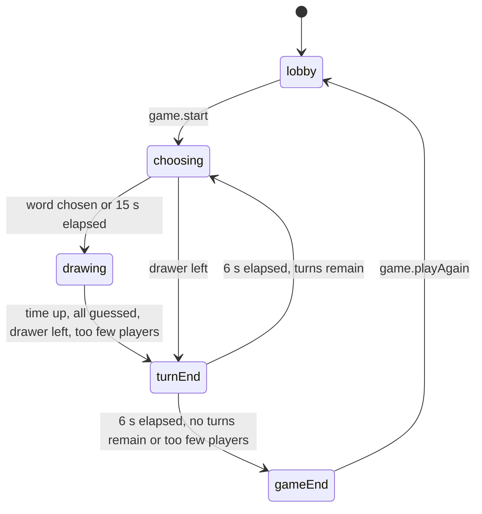

# 002 — Game loop

|           |          |
| --------- | -------- |
| Status    | Proposed |
| Milestone | M1       |

## Intent

The game loop is the rhythm of Kritzel: who draws, when, for how long, and what ends a turn. It must be predictable for players and fully deterministic for tests.

## Behaviour

A game consists of rounds; in each round every player is the drawer once.

1. **Choosing.** The drawer is offered word choices and picks one. Everyone else sees "_Name_ is choosing a word…". If the drawer does not pick in time, the server picks one of the offered words at random.
2. **Drawing.** The drawer draws; guessers see the mask and guess in chat. Hints appear over time (spec 006). The turn ends when time runs out or every guesser has guessed.
3. **Turn end.** Everyone sees the word and the points earned this turn. Then the next drawer's choosing phase begins.
4. **Game end.** After the last turn of the last round the results are shown (spec 008). The host can start over (spec 001).

## Rules

### Phases

| Constant         | Value              |
| ---------------- | ------------------ |
| Choosing time    | 15 s               |
| Drawing time     | `drawTime` setting |
| Turn-end display | 6 s                |

### Turn order

- Players draw in the order they joined the room.
- A round's order is fixed when the round starts and contains every player seated at that moment. A player who joins during a round is appended to that round's order (spec 007).
- A player who is disconnected or gone when their turn comes is skipped without a turn-end display.
- A round ends when its order is exhausted; the game ends after `rounds` rounds.

### Turn

- At the start of drawing, the **guessers** of the turn are all connected players except the drawer. This set is fixed for the turn and is the basis for "all guessed" and for the drawer's points (spec 005).
- The canvas is empty at the start of each turn.

### Turn-end reasons

| Reason               | Trigger                                                                           | Effect                                                               |
| -------------------- | --------------------------------------------------------------------------------- | -------------------------------------------------------------------- |
| `time_up`            | Drawing time elapsed                                                              | Normal scoring                                                       |
| `all_guessed`        | Every guesser of the turn who is still connected has guessed                      | Normal scoring                                                       |
| `drawer_left`        | The drawer was kicked, or stayed disconnected for 10 s during choosing or drawing | Guessers keep their points; the drawer earns 0                       |
| `not_enough_players` | Fewer than two connected players remain                                           | Guessers keep their points; the game ends after the turn-end display |

### Snapshot contents

Every snapshot contains the phase, the round number and total, the drawer, `phaseEndsAt`, and `serverNow`. During drawing it contains the mask for guessers who have not guessed and the word for the drawer and for players who have guessed. From turn end on it contains the word for everyone.

## Acceptance criteria

- **AC-002-01** After `game.start`, the phase is `choosing`, the round is 1, and the drawer is the earliest-joined player.
- **AC-002-02** In the choosing phase the drawer, and only the drawer, receives `word.choices` with exactly `wordChoices` distinct words.
- **AC-002-03** `word.choose` with a valid index from the drawer moves the room to `drawing` with that word and `phaseEndsAt` equal to now plus `drawTime`.
- **AC-002-04** `word.choose` from anyone but the drawer, or with an index out of range, is rejected and changes nothing.
- **AC-002-05** When 15 s pass in the choosing phase without a choice, the room moves to `drawing` with one of the offered words.
- **AC-002-06** During drawing, the snapshot of a guesser who has not guessed contains the mask and not the word; the snapshots of the drawer and of a player who has guessed contain the word.
- **AC-002-07** When the drawing time elapses, the room moves to `turnEnd` with reason `time_up`, and every snapshot contains the word.
- **AC-002-08** When the last guesser who has not yet guessed submits a correct guess, the room moves to `turnEnd` with reason `all_guessed` before the drawing time elapses.
- **AC-002-09** After 6 s in `turnEnd` the room moves to `choosing` with the next player in the round's order as drawer, and the op log is empty.
- **AC-002-10** With three players and `rounds` set to 2, the game has exactly six turns, each player draws exactly twice, and the room then moves to `gameEnd`.
- **AC-002-11** A player who is disconnected when their turn comes is skipped: the room goes directly to choosing for the following player.
- **AC-002-12** If the drawer disconnects during drawing and does not return within 10 s, the turn ends with reason `drawer_left`.
- **AC-002-13** If the drawer disconnects during drawing and returns within 10 s, the turn continues with unchanged `phaseEndsAt`.
- **AC-002-14** If a disconnect leaves fewer than two connected players during a game, the turn ends with reason `not_enough_players` and the next phase is `gameEnd`.
- **AC-002-15** No word is offered twice within one game as long as unused words remain in the pool.
- **AC-002-16** Every snapshot carries `serverNow`, and a client whose clock is 30 s off still shows a countdown within one second of the server's remaining time.
- **AC-002-17** Given the same initial state, event sequence, clock values and random sequence, the reducer produces the same final state.

## Out of scope

Pausing a game, skipping a turn by vote, changing settings during a game, a time bonus for the drawer.
